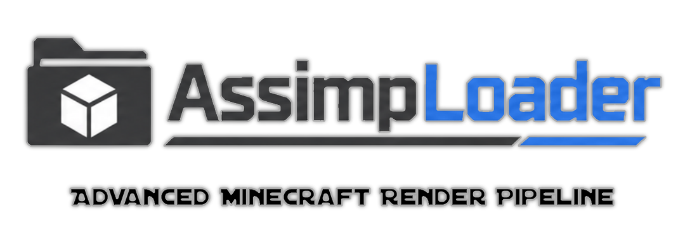
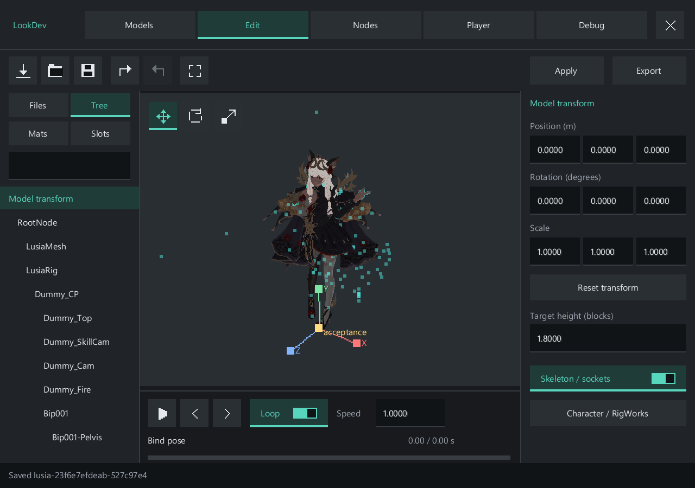
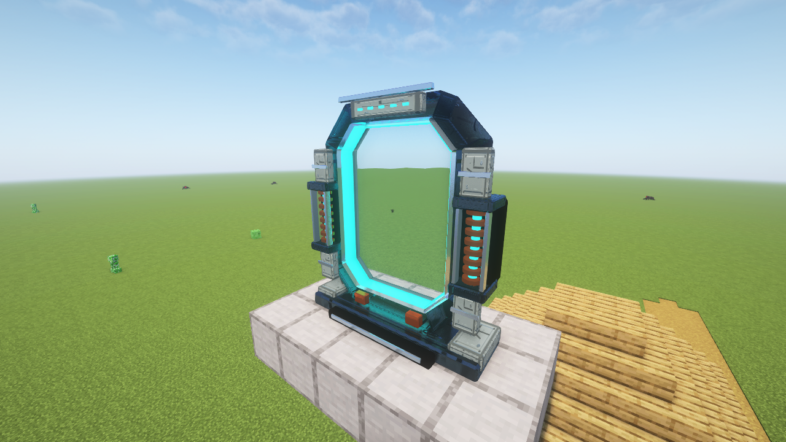
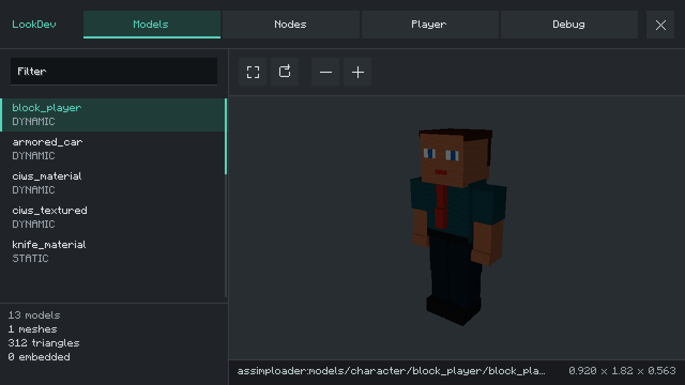
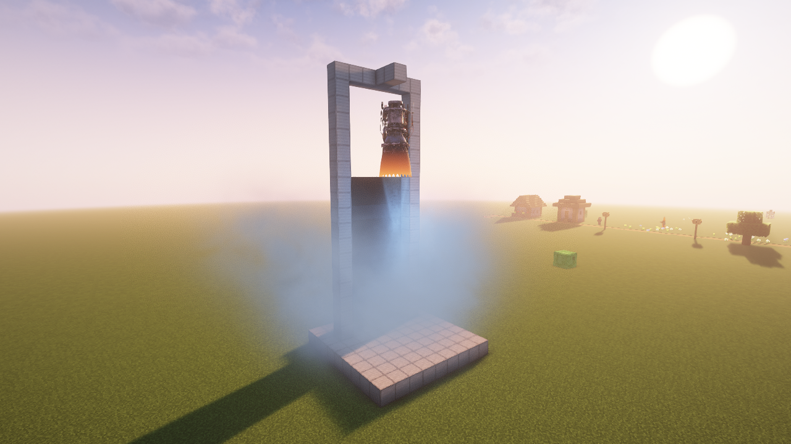

# AssimpLoader



<p align="center">
  <a href="README.en.md">English</a> · <a href="README.md">中文</a>
</p>

**A 3D asset, animation and GPU rendering engine that brings FBX / glTF / GLB into Minecraft.**

Available for Forge 1.20.1 and NeoForge 1.21.1. Assets exported from Blender keep their materials, node hierarchy, skeletons and animation — no hand-written entity renderer required.

The player-character layer lives in the separate [RigWorks](https://github.com/MineRealms/RigWorks) mod, which consumes this engine through a Git submodule.

## Features

### Models and materials

- Native Assimp parsing of FBX / glTF / GLB, static and dynamic import, embedded or external textures, full node hierarchy and pivots
- PBR workflow: base color, normal, metallic / roughness, AO, emission, transparency and alpha cutout
- LabPBR for Oculus / Iris, plus image-based lighting (irradiance, prefilter, BRDF LUT)

### GPU rendering

- Hardware skinning with a 256-bone palette, over both Compute SSBO and TBO paths
- Persistent mesh buffers and a bone-matrix TBO; the main pass and shadows reuse the same pose instead of re-skinning on the CPU
- Instanced batching with Multi-Draw Indirect, Hi-Z occlusion culling and frustum culling
- Capability detection picks the path automatically, falling back to vertex attributes and CPU skinning when uniform buffers are unavailable

### Animation and physics

- Animation state machine: states, transitions, crossfade blending, interruption at any point
- Layered blending, additive layers and per-bone masks for combining vanilla motion with imported clips
- Morph targets for facial and shape variation
- IK: LookAt head tracking, foot placement, chain IK and presets
- Spring Bone secondary motion with sphere / capsule colliders
- Bullet physics: rigid bodies, joints, ragdoll and world collision

### Collision

- Four collider modes: AABB, OBB (PCA fit), mesh (BVH) and bone (capsule)
- Raycasts against both static and skinned, deformed meshes

### In-game workbench

- Built on native Minecraft Screen, no ModernUI dependency
- File import, dedicated GPU preview, hierarchy tree, transform, material parameters, sockets, timeline, undo / redo
- Project save and reload; source meshes, UVs, skin weights and keyframes are never rewritten
- Section and page registration API so other mods extend the same workbench

### Scripting and effects

- Optional KubeJS API and JSON animation processors, with hot reload
- Bone particle emitters, socket trail ribbons, UV scrolling
- Debug views: model list, material diagnostics, skeleton / bounds / collision overlays, performance HUD

## Screenshots

| Model workbench | PBR and shaders |
| --- | --- |
|  |  |
|  |  |

## Getting started

Requires **Minecraft 1.20.1 + Forge 47.x + Java 17**, or **Minecraft 1.21.1 + NeoForge 21.1.x + Java 21**.

The release JAR bundles the Assimp bindings and native libraries for all six platforms, for example `versions/1.20.1-forge/build/libs/assimploader-1.20.1-1.0.0-forge.jar`. A thin JAR is not a substitute.

```powershell
.\gradlew.bat buildAndCollect --console=plain
.\gradlew.bat :1.20.1-forge:runClient -PwithKubeJS --console=plain
```

Builds use [Stonecutter](https://stonecutter.kikugie.dev/): `versions/1.20.1-forge` and `versions/1.21.1-neoforge` are separate subprojects sharing the root `build.gradle`. `buildAndCollect` gathers both release JARs into `build/distributions`.

FABRIK IK uses the Java solver by default. Set the client config `runtime.nativeIkEnabled` to opt into the native solver. Release JARs already bundle precompiled FabriKNative libraries for eight platforms, and ordinary builds do not compile C++. The source now lives in `native/FabriKNative` and is used by native rebuilds by default; `-PfabrikNativeDir` can point to another checkout. If enabled on a platform where the library cannot load, creating a FABRIK chain reports an error rather than silently falling back. To rebuild the bundled libraries, install the Zig toolchain and run:

```powershell
.\gradlew.bat :1.21.1-neoforge:jar -PbuildNative --console=plain
```

To validate another checkout, add `-PfabrikNativeDir=H:/path/to/FabriKNative`.

The `FABRIK_NATIVE_DIR` environment variable can replace `-PfabrikNativeDir`. The source directory must provide `build_all.bat` on Windows or `build_all.sh` on Unix and produce all eight manifest artifacts. The vendored source, C ABI header and tests are under `native/FabriKNative`; build directories and local Zig toolchains are not committed. The prebuilt outputs remain separately under `src/main/resources/native/fabrik`.

In game, press `L` or run `/lookdev` to open the workbench, then import, edit and save projects under `Edit`.

## Documentation

| Topic | Docs |
| --- | --- |
| Art assets | [PBR spec](docs/guides/PBR_ASSET_SPEC.md) · [Large models](docs/guides/LARGE_MODELS.md) |
| Materials and shaders | [Oculus PBR](docs/guides/OCULUS_PBR_USAGE.md) · [Rendering integration](docs/reference/RENDERING_INTEGRATION.md) · [GPU batch policy](docs/reference/GPU_BATCH_POLICY.md) |
| Animation and scripting | [Animation guide](docs/guides/ANIMATION_USAGE_GUIDE.md) · [Processors](docs/reference/ANIMATION_PROCESSORS.md) · [KubeJS](docs/guides/KUBEJS_INTEGRATION.md) |
| Workbench | [Model workbench](docs/guides/MODEL_WORKBENCH.md) · [Section and page registration](docs/guides/WORKSPACE_EXTENSIONS.md) · [Project format](docs/reference/WORKBENCH_PROJECT_FORMAT.md) |
| Asset automation | [Agent workflow](docs/guides/AGENT_ASSET_WORKFLOW.md) · [DCC exporters](docs/guides/DCC_EXPORTERS.md) · [Skill](skills/assimploader-asset-pipeline/SKILL.md) |
| Examples | [Showcase and CIWS](docs/showcase/MODEL_SHOWCASE.md) · [Armored car](docs/showcase/VEHICLES.md) · [Rocket exhaust](docs/showcase/ROCKET_EXHAUST.md) |
| Everything | [Docs index](docs/README.md) · [Roadmap](docs/roadmap/IN_GAME_WORKBENCH_TODO.md) |

## License

[MIT](LICENSE). Dependency and third-party notices are in [THIRD_PARTY_NOTICES](docs/THIRD_PARTY_NOTICES.md).
