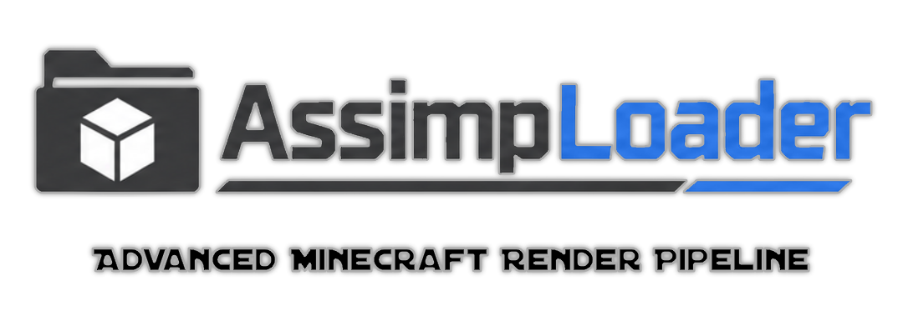
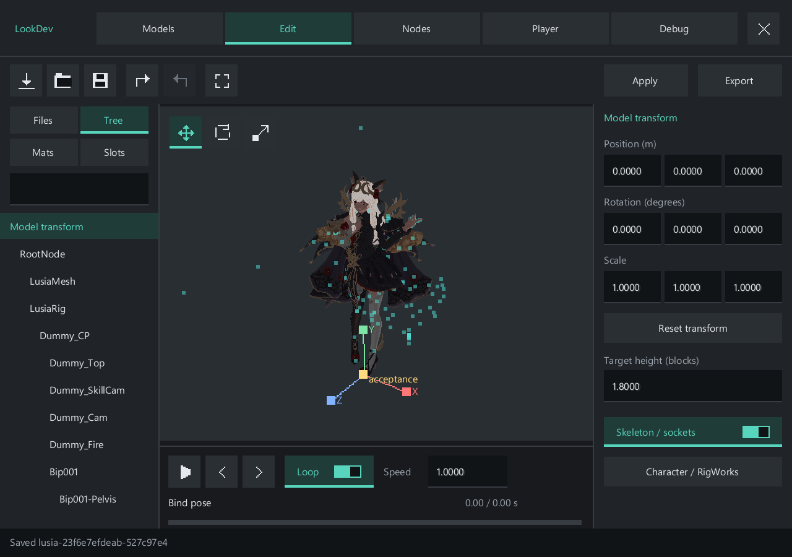
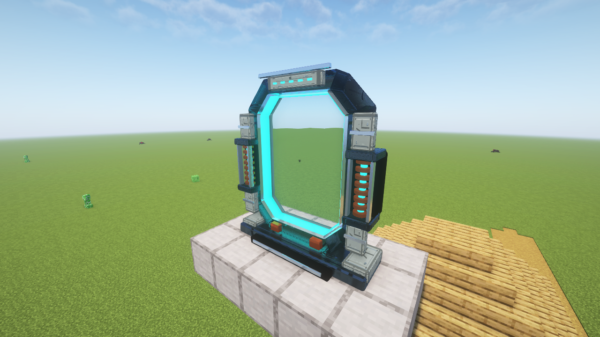
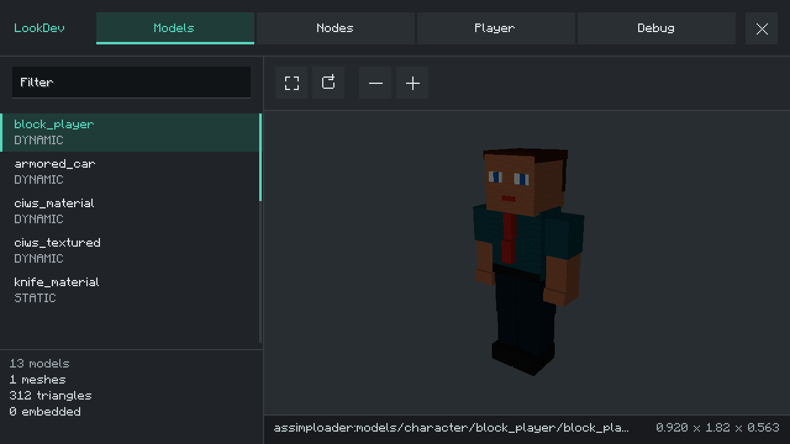
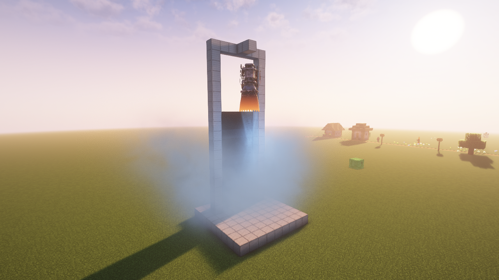

# AssimpLoader



<p align="center">
  <a href="README.en.md">English</a> · <a href="README.md">中文</a>
</p>

**把 FBX / glTF / GLB 直接带进 Minecraft 的 3D 资产、动画与 GPU 渲染引擎。**

支持 Forge 1.20.1 与 NeoForge 1.21.1。从 Blender 导出到进入游戏，材质、节点层级、骨骼与动画原样保留，不用再手写一个方块实体渲染器。

玩家角色应用是独立的 [RigWorks](https://github.com/MineRealms/RigWorks)，它通过 Git 子模块复用本引擎。

## 特性

### 模型与材质

- Assimp 原生解析 FBX / glTF / GLB，静态与动态导入、嵌入或外部贴图、完整节点层级与枢轴
- PBR 工作流：Base Color、Normal、Metallic / Roughness、AO、Emission、透明与裁切
- LabPBR 对接 Oculus / Iris，IBL 环境光照（irradiance、prefilter、BRDF LUT）

### GPU 渲染

- GPU 硬件蒙皮，骨骼调色板上限 256，Compute SSBO 与 TBO 两种路径
- 常驻网格缓冲与骨骼矩阵 TBO，主画面和阴影复用同一份姿态，不重复 CPU 蒙皮
- 实例批处理 + Multi-Draw Indirect，Hi-Z 遮挡剔除与视锥剔除
- 能力探测自动选择路径，统一缓冲不可用时回退顶点属性与 CPU 蒙皮

### 动画与物理

- 动画状态机：状态、转换、crossfade 过渡、随时中断
- 分层混合、加法层与骨骼遮罩，原版动作与导入片段自由组合
- Morph Target 形态键，覆盖面部与形状变化
- IK：LookAt 头部追踪、脚部贴地、链式 IK 与预设
- Spring Bone 弹簧骨骼物理，支持球 / 胶囊碰撞体
- Bullet 物理：刚体、关节、布娃娃与世界碰撞

### 碰撞

- 四级碰撞体：AABB、OBB（PCA 拟合）、Mesh（BVH）、Bone（胶囊）
- 射线检测，静态网格与蒙皮变形后的网格都能命中

### 游戏内工作台

- 原生 Minecraft Screen 界面，不依赖 ModernUI
- 文件导入、独立 GPU 预览、层级树、Transform、材质参数、挂点、时间轴、撤销 / 重做
- 项目保存与重开；原始 Mesh、UV、蒙皮权重与关键帧不被改写
- 分区与功能页注册接口，其他模组接入同一套工作台

### 脚本与特效

- 可选 KubeJS API 与 JSON 动画处理器，支持热重载
- 骨骼粒子发射器、挂点拖尾条带、UV 滚动
- 调试面板：模型列表、材质诊断、骨架 / 包围盒 / 碰撞显示、性能 HUD

## 截图

| 模型工作台 | PBR 与光影 |
| --- | --- |
|  |  |
|  |  |

## 快速开始

需要 **Minecraft 1.20.1 + Forge 47.x + Java 17**，或 **Minecraft 1.21.1 + NeoForge 21.1.x + Java 21**。

产物是包含 Assimp 绑定与六平台原生库的完整 JAR，例如 `versions/1.20.1-forge/build/libs/assimploader-1.20.1-1.0.0-forge.jar`。普通薄 JAR 无法替代。

```powershell
.\gradlew.bat buildAndCollect --console=plain
.\gradlew.bat :1.20.1-forge:runClient -PwithKubeJS --console=plain
```

构建使用 [Stonecutter](https://stonecutter.kikugie.dev/)：`versions/1.20.1-forge` 与 `versions/1.21.1-neoforge` 各是一个子项目，共享根 `build.gradle`。`buildAndCollect` 把两个节点的发布包汇总到 `build/distributions`。

FABRIK 逆运动学默认使用 Java 求解器。客户端配置中的 `runtime.nativeIkEnabled` 可显式启用原生求解器；发布 JAR 已包含八个平台的 FabriKNative 预编译库，普通构建不编译 C++。源码现在随仓库放在 `native/FabriKNative`，开启 native 重建时会默认使用它；也可以用 `-PfabrikNativeDir` 指向另一份源码。开启后若当前平台的原生库无法加载，创建 FABRIK 链会报错，不会静默回退。需要从源码重建这些库时，准备 Zig 工具链并运行：

```powershell
.\gradlew.bat :1.21.1-neoforge:jar -PbuildNative --console=plain
```

需要验证另一份 checkout 时，再追加 `-PfabrikNativeDir=H:/path/to/FabriKNative`。

也可以设置环境变量 `FABRIK_NATIVE_DIR` 代替 `-PfabrikNativeDir`。源码目录必须提供 Windows 的 `build_all.bat` 或 Unix 的 `build_all.sh`，并产生清单要求的八个平台文件。默认源码、C ABI 头文件和测试位于 `native/FabriKNative`；预编译产物仍单独放在 `src/main/resources/native/fabrik`，不会把构建目录或本地 Zig 工具链提交进仓库。

进入世界后按 `L` 或执行 `/lookdev` 打开工作台，在 `Edit` 中导入、编辑并保存项目。

## 文档

| 主题 | 文档 |
| --- | --- |
| 美术资产 | [PBR 接入规范](docs/guides/PBR_ASSET_SPEC.md) · [大型模型](docs/guides/LARGE_MODELS.md) |
| 材质与光影 | [Oculus PBR](docs/guides/OCULUS_PBR_USAGE.md) · [渲染集成](docs/reference/RENDERING_INTEGRATION.md) · [GPU 批处理策略](docs/reference/GPU_BATCH_POLICY.md) |
| 动画与脚本 | [动画指南](docs/guides/ANIMATION_USAGE_GUIDE.md) · [处理器](docs/reference/ANIMATION_PROCESSORS.md) · [KubeJS](docs/guides/KUBEJS_INTEGRATION.md) |
| 工作台 | [模型工作台](docs/guides/MODEL_WORKBENCH.md) · [GUI 分区与页面注册](docs/guides/WORKSPACE_EXTENSIONS.md) · [项目格式](docs/reference/WORKBENCH_PROJECT_FORMAT.md) |
| 资产自动化 | [Agent 工作流](docs/guides/AGENT_ASSET_WORKFLOW.md) · [三种软件导出](docs/guides/DCC_EXPORTERS.md) · [Skill](skills/assimploader-asset-pipeline/SKILL.md) |
| 示例 | [模型展台与 CIWS](docs/showcase/MODEL_SHOWCASE.md) · [装甲车](docs/showcase/VEHICLES.md) · [火箭尾焰](docs/showcase/ROCKET_EXHAUST.md) |
| 全部资料 | [文档索引](docs/README.md) · [路线图](docs/roadmap/IN_GAME_WORKBENCH_TODO.md) |

## 许可

[MIT](LICENSE)。依赖与第三方源码的许可见 [第三方声明](docs/THIRD_PARTY_NOTICES.md)。
