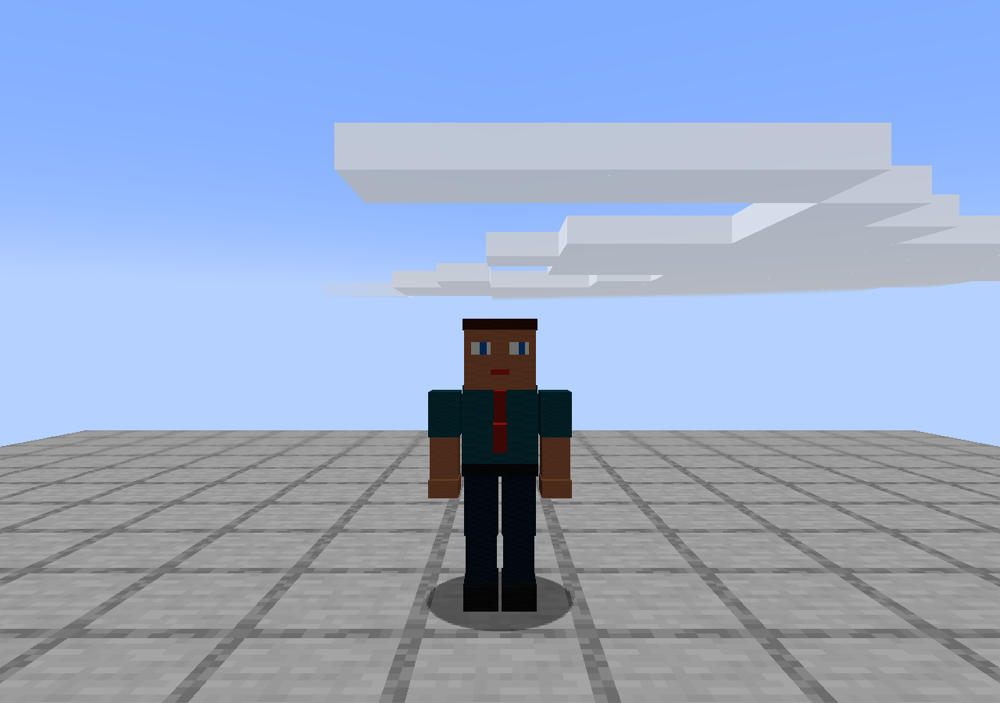
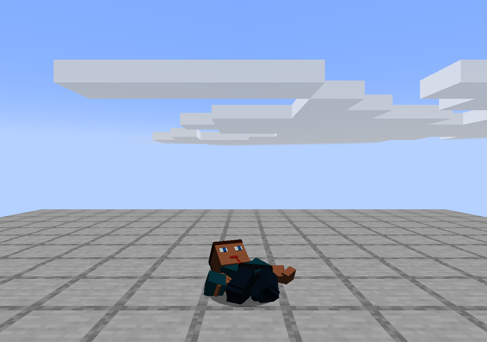
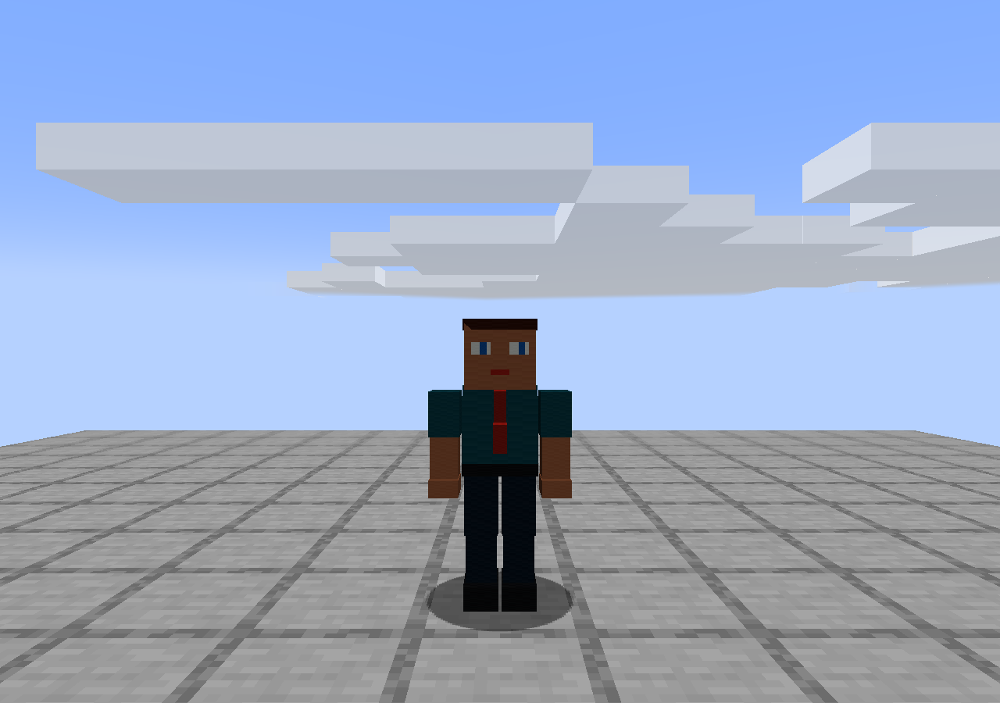

# Character engine implementation ledger

Started 2026-11-17, based on AssimpLoader `5cd4523`.

## Authorized Scope

Block-style Blender player, FBX/GLB plus versioned semantic JSON, local player
replacement, player-driven animation, skeletal constraints and real rigid-body
physics. Build engine semantics analogous to MMD before adding PMX/VMD parsing.
Equipment, display timeline and user workflow follow the core. Client visuals
must not change server movement, AABB, collision or damage authority.

## Work In Progress

- [x] Independent Blender rig, weighted meshes, actions, Morph/PBR fixtures.
- [x] Typed character profile, player inputs and animation priority/controller.
- [x] Local third-person world rendering, lifecycle, fallback and consistent visual frame.
- [x] Bullet rigid bodies, joints, collision, ragdoll and bounded world sampling.
- [x] Format-independent append/IK/bone/group morph stages and numerical fixtures.
- [x] Runtime validation, delayed captures and completed-frame diagnostics.
- [x] Physical hand equipment sockets, profile menu and semantic motion controls.
- [x] Native attack phase/cadence synchronization and forward crouch knee poles.
- [x] Optional KubeJS player policies, editable action library and solver controls.
- [ ] Armor, first-person/remote-player rendering and camera/audio display timeline.

No completion or runtime claim follows from adding a source file or dependency.
PMX/VMD binary parsers are out of scope. Preserve unsupported feature diagnostics.

## Subsequent Acceptance

Run `1794855778366` passed all 13 actual-player stages with 10.5-second settling:
idle, IK, expression, ragdoll, restore, reload, both equipment hands, semantic
motion, menu, crouch, rapid native swings and invalid-profile fallback.
That build had 358 tests: 357 passed and one opt-in benchmark skipped.
The crouch checks assert forward knee positions and grounded ankle height;
rapid swings compare normalized model phase to Minecraft's accepted phase.

The new optional player-policy API and independent Mo' Bends-style script demo
are described in [KubeJS player actions](CHARACTER_KUBEJS_ACTIONS.md). This keeps
action decisions/curves editable while Java owns pose, physics and skinning.
The final KubeJS extension build passes 367 tests (366 passed, one opt-in
benchmark skipped), and the real client/Rhino acceptance reports success.
That gate checks the canonical script and actual Assimp handles with synthetic
input; new script actions have not each received an in-world visual review.

## Numerical Acceptance

2026-11-17: full `gradlew test jarJar runClient` completed successfully:
338 tests, 337 passed, one opt-in benchmark skipped. Character tests: 29 passed.
FBX and GLB contain exactly the 15 authored actions after restricting export to
this scene's NLA tracks. Both retain the skeleton, Blink and Smile morphs.
Blender reports zero unweighted vertices (624 vertices, 312 triangles, 23 bones).
FBX idle geometry: floor approximately zero, maximum Y approximately 1.828 m.
Limited knee IK on the actual FBX reaches 0.000938 m error.

The actual FBX physics fixture has 17 bodies and 16 joints. Rest joint frames
coincide numerically. Each of scales 0.5, 1 and 2 survives animated secondary
motion, five seconds of ragdoll/floor collision and return to animation, with
1,326 fixed steps, zero discarded time and finite bodies inside the test region.
FBX retains a 100x bone unit scale: physical bone frames explicitly remove it,
while rendered bone transforms preserve it. Shape dimensions and offsets are
metres in rigid bone axes. The profile's uniform visual scale affects shapes,
joint offsets, target positions and feedback together.

FBX import through Assimp 5.2.x gives single-shape channels default weight 1.
The rig's explicit `defaults` restores the authored zero expression; it does not
globally rewrite other imported models. Group morphs are flattened with cycle
and depth checks before per-frame evaluation.

## Actual Player Acceptance

Run `1794852271688` completed seven stages using the actual local-player event
renderer in the disposable `Character_BlockPlayer_Acceptance` world. Each stage
settled for at least 10.5 seconds. Stages: idle, constrained leg IK, group expression,
ragdoll, animation restore, owner reload and invalid-profile vanilla fallback.
All stage assertions passed, and screenshots were inspected for colored geometry
and physical collapse. Albedo, normal and packed specular channels were ready.
Player physical width and height stayed unchanged. Ragdoll sampled 25 loaded-block
collision proxies, used 17 bodies/16 joints and discarded zero simulation time.
Reload/failure closed the former physics and animation owners.

An earlier run passed numerical assertions but revealed black generated PNGs.
Changing color space after assigning generated pixels had cleared their contents.
The builder now selects color space before filling pixels, and an asset regression
test checks albedo variance and the tangent-space normal. Only the corrected run
above is accepted as visual evidence.

See [Blender workflow](CHARACTER_BLENDER_WORKFLOW.md) for reusable re-export,
resource ownership, units and client commands. The exporter validation in live
Blender confirmed 24 blended vertices, zero missing/unnormalized weights, exact
15 tracks, a floor within 0.000001 m of zero and a height of 1.825 m.

Equipment, first-person arms, display timeline and profile-selection UI are
separate extensions. Enable/disable/profile/reload/morph/ragdoll client commands
are available. SDEF/QDEF, UV/material/flip/impulse morph and imported motion-track
semantics are not claimed complete by this core acceptance.

## Sources And Evidence

Public implementation documentation, not an official exhaustive format standard:

- [babylon-mmd model behavior](https://noname0310.github.io/babylon-mmd/docs/reference/understanding-mmd-behaviour/introduction-to-pmx-and-pmd/)
- [babylon-mmd motion behavior](https://noname0310.github.io/babylon-mmd/docs/reference/understanding-mmd-behaviour/introduction-to-vmd-and-vpd/)
- [JBullet upstream](https://github.com/stephengold/jbullet), version 1.0.3,
  zlib license; vecmath 1.5.2 and stack-alloc 1.0.2 are explicit runtime dependencies.

The user authorized reference to the CustomSteve analysis tree and live Ghidra.
Ghidra target observed 2026-11-17: `df_java_bridge.dll`, x86-64 PE,
SHA-256 `dc13e3f11e4a95b02a1778d6242a534b2cffcaefc2d67454cf3f5f42e8933d97`.
Export inventory confirms separate bone Morph, grants, IK, skinning and physics
service boundaries. This is static interface evidence, not observed runtime
behavior or copied implementation. New engine code and test assets are independent.

Connected Blender: 5.3.0. Existing deer scene must be preserved; create a separate
character scene/project. Screenshot acceptance waits at least ten seconds.
