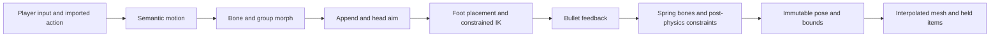

# Character Solver Engine Report

## Scope

The first Blender-to-AssimpLoader player loop now uses independent block-style
assets and versioned format-neutral sidecars. It exercises skinning, skeletal
constraints, secondary motion, rigid bodies, joints and ragdoll through the
local player's actual world render. PMX/VMD binary import remains excluded.

## Implemented Surface

| Area | Current implementation | Boundary |
| --- | --- | --- |
| Asset creation | Saved Blender scene, FBX/GLB, 23 bones, 15 baked action tracks, weighted mesh, PBR, Blink/Smile | Compact test art; authoring IK is separate from runtime solver |
| Player layer | Local third-person replacement, action priorities, head/body aim, async lifecycle and vanilla fallback | Remote players, first-person and inventory preview are separate |
| Skinning | Reuses AssimpLoader skin/Morph/render backends and immutable interpolated snapshots | LBS; no SDEF/QDEF claim |
| Rig solving | Rest-relative append transforms, constrained CCD/hinge limits, pre/post physics stages | Not every format's transform-order variant |
| Morph | Imported vertex, bone and nested group morphs, cycle checks and explicit defaults | UV/material/flip/impulse types remain missing |
| Semantic motion | Independent XYZ/rotation Bezier timing, linear Morph, stepped IK; play/pause/seek/loop/stop | No camera/light/visibility tracks, audio timeline or root extraction |
| Physics | Bullet worlds, BOX/SPHERE/CAPSULE, collision masks, FOLLOW/DYNAMIC/HYBRID feedback, 6DOF joints, bounded springs, ragdoll | Rigid skeletal physics; not cloth/soft-body simulation |
| World alignment | Loaded client block collision proxies, foot placement, double-coordinate anchor and teleport reset | Never changes authoritative entity AABBs/movement/damage |
| Held items | Physical left/right sockets read the same interpolated pose as the mesh; vanilla item renderer | Armor, cape, elytra mesh and per-item grip poses remain separate |
| User controls | Client TOML, commands, resource-pack profile menu, reload and diagnostics | No network profile selection or downloadable model browser |

## Evaluation Order

Simulation advances once per animation update. Render passes read completed
snapshots and do not step physics. Multiple consumers can retain a snapshot
without subsequent updates changing its matrices or morph weights.

## Performance Controls

The existing GPU skinning, Morph and rendering choices remain available.
Character physics uses a mature Java Bullet implementation with bounded work:
fixedStep, maxSubsteps, solverIterations, shape/body/joint capacities and world
proxy limits. The fixture uses 1/120-second steps, at most eight steps/update,
17 bodies, 16 joints and at most 128 world proxies.

Client TOML can disable physics or world collision, change loaded-block sampling
interval/radius, and disable foot placement/effects. Solver and mesh settings
are resource-pack data. A 100x FBX bone scale is removed for physical metre-space
offsets and equipment; render transforms retain their imported scale.

No new native or compute physics backend is justified by the current acceptance
data: no comparative CPU timing study has been performed. This is not a claim
that Java will handle arbitrary avatar counts. Native/SIMD/GPU work should follow
measured solver/deformation cost under a representative population and preserve
the current semantic and snapshot contracts.

## Verification And Remaining Work

The numerical suite covers actual imported FBX/GLB assets, IK accuracy,
group/mesh/bone morphs, curve sampling, motion lifecycle, physical contact and
17-body ragdoll at scales 0.5/1/2. The progress ledger records full test counts,
actual-player runs and inspected screenshots:
[acceptance ledger](CHARACTER_ENGINE_PROGRESS.md).

The reusable exporter has also executed against live Blender. It preserves the
deer scene and restores UI selection/action/NLA state. It checks weight sums,
blended vertices, named actions and metre-space bounds before export.

This does not establish that future PMX/VMD support is only a parser task.
Adapters still need coordinate/curve conversion and explicit handling of the
unsupported semantic types above. Generic retarget calibration, root-motion
rules, remote-player ownership, armor/first-person layers and synchronized
display/audio/camera timelines remain expansion work. They must not be marked
complete from the block-player fixture.

## References

See the [acceptance ledger](CHARACTER_ENGINE_PROGRESS.md#sources-and-evidence)
for the primary implementation references and the exact Ghidra target observed.
The new assets and implementation are independent. CustomSteve export names
were interface evidence, not proof of matching runtime behavior.
