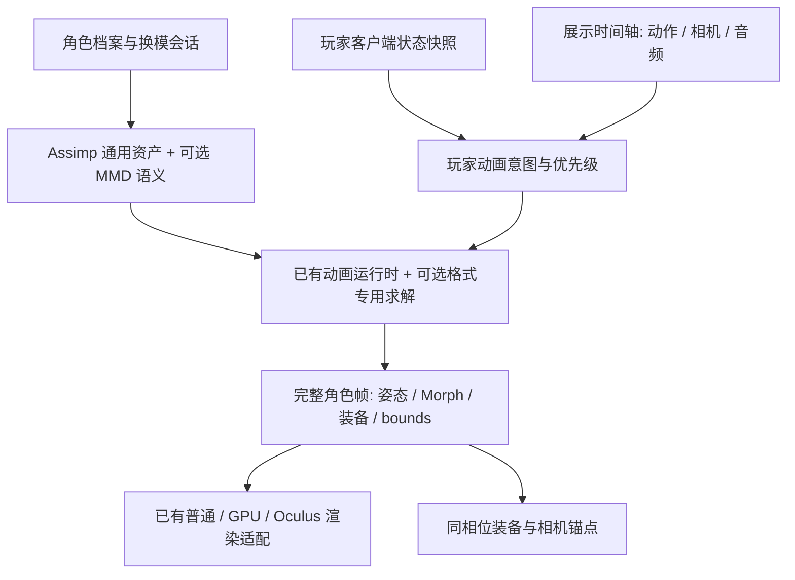

# 基于 AssimpLoader 的自定义玩家角色系统缺口评估

日期：2026-11-17。基线为 `a45969e`，仅阅读代码与文档，没有运行客户端、构建或新增功能。本次是可行性评估，不将完整 CustomSteve 自动加入当前实施范围。

参考资料：`H:/MinecraftMods/Reverse/customsteve-1.21.11-rc-hf4-analysis/docs/cleanroom/` 的 README 及 01-04 四份规格。未读取其余逆向材料。参考规格来自目标产物静态分析，不能当作目标 Mod 已完成游戏或性能验收的证明；规格中的新 ABI、故障恢复和模块划分也不是原作者实现的还原。

## 结论

AssimpLoader 已经具备通用角色底座：模型/纹理导入、独立实例、骨骼动画、crossfade、分层、Morph、IK、Spring、挂点、CPU/GPU 变形和普通/Oculus 绘制。做一个“使用 FBX/GLB 的本地玩家换模系统”，可以沿用这些核心。

离“完整自定义史蒂夫”仍有三类主要缺口：

1. **玩家产品层**：玩家显示接管、行为到动作的映射、换模/配置界面、手持装备、视角和回退。
2. **MMD 专用语义**：PMX/VMD 的动作、约束、形变、物理和材质合同，不能用“Assimp 能读模型”代替。
3. **高级角色系统**：人形重定向、展示时间轴、相机/BGM、刚体/布娃娃和可选运动匹配。

因此，主要工作量不是重新写一套绘制器，也不是先引入 Rust/C++。一个本地玩家通常没有多实例提交瓶颈，MDI/Hi-Z 对此不是核心前置条件。不能用已经完成的批处理压测推导角色系统完成比例。

## 范围区别

| 目标 | 可以复用 | 新增工作的重心 |
|---|---|---|
| FBX/GLB 本地玩家换模 | 当前模型、动画、JSON、GPU、普通材质 | 玩家绑定、基础动作、切换/回退、主手挂载 |
| PMX/VMD 本地角色系统 | 同上，加通用 IK/Morph/Spring 的部分算子 | 格式语义扩展、MMD 求值计划、动作绑定、材质与物理 |
| 展示与高级动作完整产品 | 同上 | 手势、音画相机时间轴、人形映射、刚体/布娃娃、运动库 |
| 多人角色系统 | 通用每实例运行时 | UUID 绑定、资源身份/分发、远端时间轴、协议和隐私设置；参考规格并未确认原作具备此项 |
| 1.21.11 / NeoForge 版本 | 纯数学和部分资产层可评估迁移 | 本仓库目前为 1.20.1 / Forge 47.1.3 / Java 17，游戏 API、渲染和光影适配须另立移植任务 |

第一人称完整身体/手臂、任意护甲和模组装备兼容，也需要单独确定范围。参考资料确认本地世界玩家替换，不能据此推定这些体验全部完成。

## 现有基础与逐项缺口

“可复用”表示代码基础存在，不表示已经完成玩家角色场景验收。

| 需求 | AssimpLoader 当前基础 | 仍需完成 |
|---|---|---|
| F-001 启动/能力探测 | 客户端生命周期、GL 能力判断、回退及资源清理 | 玩家角色模块的初始化、按键注册、可用能力状态 |
| F-002 配置与资产 | ResourceLocation、资源依赖、版本化 instance JSON、TOML 性能配置 | 用户模型目录/模型档案、角色选择、动作/装备/音频映射、配置迁移及诊断 UI |
| F-003 选择与发布 | AsyncModelLoader 有界队列、ModelRepository 缓存/代次、已加载模型预览 | 最后一次选择获胜、取消、旧角色保留到新角色可用、整体发布模型+动作+纹理+GPU 资源 |
| F-004 尺寸与定位 | 导入坐标转换、modelTransform、动态视觉 bounds、地面对齐 | 玩家脚点/身高校准、头身转向、视角与角色比例一致 |
| F-010 tick/显示分工 | 不可变 PoseSnapshot、客户端 tick、只读渲染插值、传送重置 | 玩家事件序号与时间、展示/音频时钟、所有角色消费者共享完成帧 |
| F-011 游戏状态输入 | 宿主 state 请求、实体位移驱动的基础 locomotion | 前后左右、走跑蹲跳/下落、头身分离、物品使用、挥手、游泳/飞行/滑翔/骑乘/睡眠的优先级和边沿事件 |
| F-012 基础动作流程 | 状态机、crossfade、中断、mask/additive、Morph 权重 | 玩家动作配置/素材、身体/手臂/表情仲裁、缺动作回退和状态退出复位 |
| F-013 世界玩家替换 | ConfiguredEntityRenderer 面向自有注册实体；车辆可隐藏乘客 | 本地玩家渲染接管、成功才取消原版、无双重身体、阴影/名字牌/可见性、独立角色预览 |
| F-020 VMD 展示 | 普通 clip 播放、暂停/速度等部分基础 | VMD 导入/绑定、倒计时、seek/循环区间、摄像机/BGM 共同时钟、停止/换世界恢复 |
| F-021 十个手势槽 | 状态请求和混合可以复用 | 每模型十槽、持久化、按键/界面、区间校验、打断/停止策略 |
| F-022 装备/物理 | 具名挂点、LookAt/CCD、脚部采样、Spring 球/胶囊 | 手持/副手/装备身份映射、同一视觉相位挂载、PMX 刚体/约束、物理反馈骨骼、布娃娃另做 |
| F-014 运动匹配 | 没有完整数据库/特征/搜索系统 | 自建数据生成、骨架/特征 schema、轨迹预测、检索/过滤、惯性过渡及无库回退 |
| F-030 材质与 GPU | 纹理/PBR 资产、透明回退、TBO/Compute、Oculus 缓存 | 角色材质子集、PMX 材质形变/toon/边缘等语义、专用权重与所有后端一致性 |
| F-031 指定光影 | 既有 Oculus 绘制与实际普通/阴影姿态验收 | 玩家接管后的 pass 接入、透明/附件与阴影一致；1.21 Iris 需重做适配，不能继承为通用兼容 |
| F-040 重载 | 资源代次失效、重载清理模型/姿态/GPU | 角色资源索引、重读当前模型、重载动作配置、重建 GPU 的用户可见语义 |
| F-041 退出/取消 | 实例 close、弱 owner、退出/重载释放、有界异步导入 | 换模任务跨阶段取消、展示/相机撤销、准备中退出、完整角色会话回收与故障注入 |
| F-050 支持声明 | 有实现和验收文档 | 玩家系统的格式子集、版本/后端/装备/光影支持矩阵，以及相应测试资产 |

## 六个容易低估的技术缺口

### 1. “能读取 PMX”与“能正确播放 MMD 角色”有距离

目前公共模型表达以 Assimp 的节点、网格、骨骼矩阵、TRS 关键帧和顶点/法线 Morph 为中心。代码未发现独立 PMX/VMD 角色语义层。没有证据证明 PMX 的约束、物理和材质元数据已被保留到当前 Java 资产结构。

需要声明并检查：追加变换、骨骼求值依赖、物理前后约束、IK 动画开关、特殊权重模式、骨骼/组/UV/材质等形变类型及其归零恢复。SDEF/QDEF 等模式须另有数据表示与求值；支持 4/8 个权重的线性蒙皮不能证明这些模式已支持。VMD 也需要独立动作绑定和曲线信息，不能只将其解释成当前通用 TRS 插值。

现有 `AnimationState` 按 `GENERAL → GROUND → IK → SPRING` 分类执行 modifier，实际实例 `ChainIkModifier` 也没有完整的逐关节限制参数。这些算子可复用，但不能原样当作 PMX 的格式依赖求值器。CPU、Vertex Shader、Compute 的现有蒙皮均以加权矩阵为基础，增加专用模式时要同时补齐资产数据和执行分派。

合理接法是保留 AssimpScene 的通用网格能力，在导入阶段附加独立的角色语义资源与专用 clip，不让所有普通 FBX/OBJ 资产承担 MMD 复杂度。是否另写格式解析器或复用成熟库，需在实现阶段依据格式覆盖与许可证评估。

### 2. 玩家渲染接管不等于注册一个 Showcase 生物

`ConfiguredEntityRenderer` 是自有实体 renderer。现有 `RenderPlayerEvent.Pre` 使用仅用于装甲车乘客隐藏，没有自定义玩家绘制链路。

需要专用 player adapter：判断本地玩家与渲染上下文，准备完整可绘制角色，成功后才隐藏原版；失败恢复原版。还要处理玩家在屏幕预览、镜像/阴影、不同可见状态下的表现。装备、原版 layer 和主模型不能各自独立决定隐藏，避免出现“原版装备悬空”或双重身体。

### 3. 玩家动作需要完整输入与仲裁

鹿的 idle/walk 位移判断不足以覆盖玩家。需要只读 `PlayerVisualInput`，包含速度方向、身体/头部朝向、姿势、在地/空中、物品使用阶段、手臂侧别和装备身份；跳跃/挥手边沿单独带序号消费。

动作层以具名输入和配置规则工作，不直接读取 Minecraft 实体。运动、上半身物品动作、头部注视和表情分层，明确冲突和退出。根运动首版建议仅影响视觉/报告增量，角色位置、碰撞和伤害继续由 Minecraft 服务端决定。

### 4. 挂点已有，但装备的视觉帧合同还缺

当前 `ModelInstance.attachmentTransform` 读取模拟 `getPoseSnapshot()`；身体绘制可使用 `getRenderPose(partialTick)`。将现有挂点直接用于插值身体的手持物，可能产生相位差。

角色绘制需发布或显式传递同一视觉快照，由身体、视觉装备和相机锚点共同消费。碰撞查询及粒子/拖尾模拟继续按既定模拟时间工作，不因每个 render pass 重复推进。还需要主/副手变换、左右手规则、物品使用动作和装备 fallback。

### 5. Spring 和碰撞查询不是刚体物理系统

现有 Spring 是模型空间的有界次级摆动，ModelCollision 提供查询；没有完整刚体世界、关节约束、PMX 动态体回写或主动布娃娃。

完整物理应引入成熟求解器，分别设计运动学/动态体、碰撞组、局部世界锚点、固定步、反馈顺序和传送重置。只提交客户端已加载地形的有界碰撞数据，Native 不读取 Minecraft 世界；视觉物理不得回写玩家权威 AABB、位置或伤害。布料和全身布娃娃各立验收，不要求首版同时交付。

### 6. 模型浏览器不等于角色资源/播放服务

已有 LoadedModelsScreen 能浏览预览缓存模型，但没有完整“选择为玩家角色”的会话。AsyncModelLoader 将解码放到工作线程，不自动保证上层不等待，也不负责角色换模的 latest-request-wins、旧角色保留或相机恢复。

新增 `CharacterSession` 管理资产代次、异步准备、动作绑定、渲染线程上传和一致发布。预览拥有独立实例与播放时间；换模/失败/退出时，一并处理手势、装备、音频和相机接管。

## 建议架构

以可选客户端角色层扩展 AssimpLoader，通用导入与渲染继续作为基础服务。

建议增加的模块而非现有类：`CharacterProfile`、`CharacterSession`、`PlayerVisualInput`、`PlayerAnimationController`、`PlayerRenderAdapter`、`HumanoidRigBinding`、`PerformanceTimeline`、`MmdAssetExtension`。先以小接口接入现有 AnimationState/ModelInstance/PoseSnapshot，不另建一套重复的通用动画引擎。

## Java、Native 与 GPU 的边界

| 工作 | 建议位置 | 原因 |
|---|---|---|
| 玩家状态/GUI/配置/按键/装备 ItemStack | Java 客户端 | 必须接入 Minecraft；Native 不能持有并自行读写可变世界对象 |
| 首版状态机、少量角色 IK/Spring | 现有 Java 运行时 | 已有基础，单玩家规模不足以证明 JNI 的必要性 |
| PMX/VMD 解码与专用依赖求值 | Java 或隔离 Native 模块，按实际复用库决定 | 首先解决语义完整和可验证输出，不能把 Native 当成格式兼容开关 |
| 大量动态刚体/约束/布娃娃 | 成熟 Native 求解器优先评估 | 主要价值是成熟物理能力；保持批量输入/输出与单一资源所有权 |
| CPU 蒙皮/密集 Morph 批处理 | 先缓存与数据布局，确有热点后 SIMD/Native | 避免逐骨骼 JNI 和额外复制抵消收益 |
| 蒙皮/Morph/重复 pass | 复用当前 GPU 与 Compute 基础 | 新格式模式仍需独立 CPU/GPU 一致性；活动 Morph 暂不能进入现有 MDI batch |
| 渲染 GL 所有权 | 继续由当前 Java 渲染线程统一持有 | 便于 Minecraft 状态恢复、预算和重载；不同时新增第二个 GL 生命周期 |
| 运动库搜索 | 小库 Java 参考，规模需要时 SIMD/Native | 库、特征、归一化与可解释结果先闭合；它不是基础动作前置条件 |

本报告不估算新系统 FPS。前一份 [渲染性能图表](benchmarks/README.md) 中的经验数字只是既定工作负载的预算参考，不能作为 PMX/VMD、玩家装备或布娃娃已测结果。

## 实施顺序与出口

| 阶段 | 内容 | 出口 |
|---|---|---|
| A 本地玩家最小闭环 | 留在当前 1.20.1；FBX/GLB；角色档案、玩家替换、待机/走跑/蹲跳、换模/失败回退 | 一个独立人形正确显示，原版身体不重复，暂停/死亡/退出/传送可恢复 |
| B 可日常使用 | 头身分离、主/副手、使用物品、视觉同相位装备、模型选择 UI、其余玩家姿势 | 游泳/滑翔/骑乘/睡眠等均有已声明动作或 fallback，装备无漂移 |
| C MMD 兼容层 | 列明 PMX/VMD 子集；保留专用元数据；形变/约束/动作曲线；各 GPU 后端降级 | 自建小夹具逐项验证，不支持特性可诊断；不能只验“某个模型打开了” |
| D 展示与次级物理 | 手势槽、统一动作/摄像机/BGM 时间轴、刚体/约束、物理开关 | 停止/换模/暂停/传送撤销接管且资源回收，音画不持续漂移 |
| E 高级可选能力 | 人形重定向、运动库、全身布娃娃、指定新版本/光影适配 | 各自独立支持矩阵和数据；不阻塞基础角色流程 |

A/B 可以在不实现 PMX/VMD 的前提下完成；若首发就必须支持 MMD，C 的格式与数学基线需要前移，工作量会明显增加。人形参考姿态映射应随需要提前到 B/C，完整跨骨架重定向留给 E。

这不是几项渲染补丁，而是角色产品层加一套可选的格式/物理专用运行时。建议先证明 A 的基础玩法价值，再决定是否承担 C/D/E 的完整范围；不建议先做网络分发、通用节点编辑器或多版本移植。

## 证据入口

- [通用实体 renderer](../src/main/java/cn/minerealms/assimploader/render/base/ConfiguredEntityRenderer.java)、[乘客隐藏](../src/main/java/cn/minerealms/assimploader/vehicle/client/ArmoredCarClientEvents.java)：前者不是玩家绑定，后者没有自定义角色输出。
- [模型加载](../src/main/java/cn/minerealms/assimploader/core/AssimpModelLoader.java)、[异步解码](../src/main/java/cn/minerealms/assimploader/core/AsyncModelLoader.java)、[资源仓库](../src/main/java/cn/minerealms/assimploader/core/ModelRepository.java)：有基础生命周期，角色换模事务仍需新增。
- [动画数据](../src/main/java/cn/minerealms/assimploader/model/AssimpAnimation.java)、[TRS 通道](../src/main/java/cn/minerealms/assimploader/animation/BoneAnimationChannel.java)、[姿态](../src/main/java/cn/minerealms/assimploader/animation/PoseSnapshot.java)：通用资产/快照基础，未发现专门的 VMD/PMX 求值语义资源。
- [求值顺序](../src/main/java/cn/minerealms/assimploader/animation/AnimationState.java)、[实例 CCD](../src/main/java/cn/minerealms/assimploader/animation/ik/ChainIkModifier.java)、[CPU 蒙皮](../src/main/java/cn/minerealms/assimploader/rendering/CpuSkinning.java)：专用约束/权重模式不能仅靠添加文件后缀支持。
- [实例与挂点](../src/main/java/cn/minerealms/assimploader/animation/ModelInstance.java)、[人形 IK preset](../src/main/java/cn/minerealms/assimploader/animation/ik/IKPresets.java)：具名骨骼配置可复用，但 preset 不等于跨骨架重定向。
- [Spring](../src/main/java/cn/minerealms/assimploader/animation/physics/SpringBoneModifier.java)、[碰撞查询](../src/main/java/cn/minerealms/assimploader/collision/ModelCollision.java)：不能归类为完整刚体/布娃娃。
- [模型预览](../src/main/java/cn/minerealms/assimploader/lookdev/ui/LoadedModelsScreen.java)、[客户端视觉权威](CLIENT_VISUAL_AUTHORITY.md)、[Compute](COMPUTE_SKINNING.md)、[Oculus 缓存](OCULUS_POSE_BUFFER_CACHE.md)、[GPU 批处理验收](GPU_BATCH_VALIDATION_2026-11-16.md)：已有能力和限制。

参考规格的 F-001～F-050、NATIVE-01～09 是需求追踪编号，不代表 AssimpLoader 已实现数量。未给出百分比或工期，因为“只支持自制 GLB”与“任意 PMX/VMD/装备/物理兼容”的任务规模并不相同。
