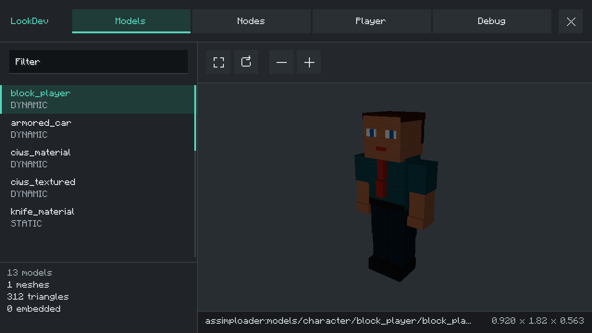
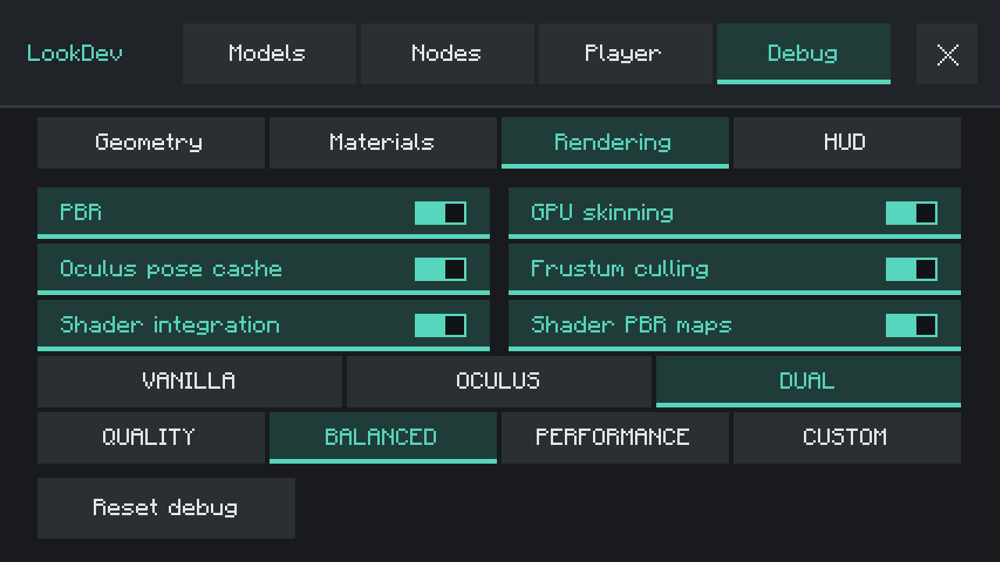
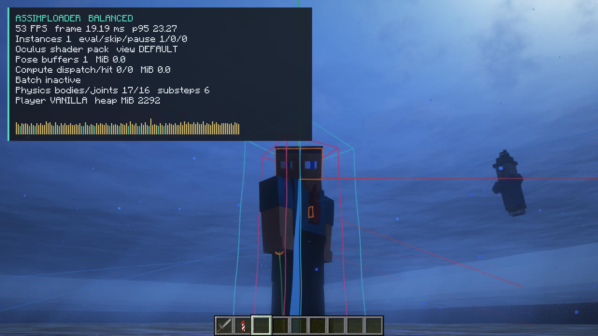

# LookDev And Client Diagnostics

Open the workspace with `L` or `/lookdev`. All active AssimpLoader menus use its
Models / Nodes / Player / Debug navigation. Models and Nodes share the selected
scene and camera. Player contains profile selection, animation mode and the
independent RigPhysics switch. Debug contains Geometry / Materials / Rendering /
HUD views. Escape and the close icon return to the game.

Active widgets are independent Minecraft render-thread controls in `FlatUi`.
ModernUI is not a runtime dependency. Historical inactive editor fragments still
use ModernUI Core as a compile/test-only dependency; the Nodes page currently
shows scene hierarchy, not a replacement material graph editor.

## Client Commands

Commands are registered only on Forge's client dispatcher. They work without
server command permissions and do not send server configuration packets.

```text
/assimploader debug on|off|reset|menu
/assimploader debug bounds|skeleton|collision|world_collision|axes|attachments on|off
/assimploader debug pbr|gpu_skinning|pose_cache on|off
/assimploader debug material default|untextured|albedo|normal|ao|roughness|metallic|emission
/assimploader debug shader vanilla|oculus|dual
/assimploader hud on|off
```

The character and debug menu commands open their respective LookDev tabs.
The performance HUD has its own switch and does not depend on F3 or the geometry
debug master switch. `debug off` restores the default material view and hides
gizmos while preserving the chosen options for the next activation. `debug reset`
resets diagnostic options, not the rendering policy or PBR configuration.

Configuration lives in `AssimpLoaderConfig.CLIENT.debugView`:

- BooleanValue: enabled, hud, bounds, skeleton, collision, worldCollision, axes,
  attachments. All false by default except bounds=true; enabled gates geometry.
- EnumValue<AssimpLoaderConfig.MaterialView>: material.
- IntValue: hudScale (1..3).
- MaterialView: DEFAULT, UNTEXTURED, ALBEDO, NORMAL, AO, ROUGHNESS, METALLIC,
  EMISSION. Material view takes effect only when enabled. HUD independent of
  enabled and independent of F3. Material images are packed LabPBR diagnostics.

## Rendering And Limits

The GUI and commands persist the same client configuration. Rendering controls
switch existing PBR, shader integration, skinning, pose cache, frustum and runtime
policies. Installing Oculus does not select or enable a shader pack. Development
clients include Oculus and Embeddium by default; `-PwithoutOculus` opts out.

Material views extract the packed LabPBR input channels into ordinary albedo
diagnostic textures. Conversion runs on the bounded texture worker pool and GL
upload runs on the render thread. Images are capped at 1024 pixels per dimension,
cached per material/view and released with the model texture cache. Normal
reconstructs positive Z from packed XY; AO reads packed normal B; roughness is
one minus smoothness; metallic shows the LabPBR metal class threshold; emission
reads packed specular alpha. Missing channels use neutral values. Shader-pack
lighting still applies to world diagnostic textures. This is an input-channel
view, not an HDR render-target inspector. Dynamic/posed models and the LookDev
preview use these textures; previously baked atlas geometry is not rewritten.

Debug material views bypass cached posed/static draw paths whose tint would be
stale. Geometry debug bypasses world batching so individual gizmos can be
submitted. Therefore HUD values with diagnostics enabled include that cost.

Geometry uses
`DebugGeometryRenderer.render(scene, snapshot, configuredInstance, poses, buffers)`
from shared draw paths. It skips disabled/shadow passes, caps traversal at 256
nodes and collision/attachment lists at 128, and submits buffered line geometry.
Bounds are conservative animation bounds, not exact per-frame triangle bounds.
Physics debug draws actual local Bullet body transforms and nearby world proxy
boxes; the vanilla player AABB is shown separately. These are read-only visual
observations and never change authoritative server collision or damage.

The HUD samples text at 4 Hz and keeps 120 frame intervals. FPS, mean/p95 frame
intervals, animation evaluations/skips, pose-cache memory, compute dispatch/hit
totals, previous batch submissions, physics counts and heap use are real runtime
counters. Frame intervals include frame limiting and are not CPU or GPU execution
timings. No fabricated GPU timing is displayed. The HUD is hidden while a GUI is
open and follows Minecraft's normal HUD visibility.

## Acceptance

The Oculus + active `RocketFlow_Local` shader-pack run `1794882904162` passed
22 stages at GUI sizes 640x360 and 427x240. Captures were taken after 10.5 seconds
per stage. It exercised actual player rendering, physics owner cleanup, script
execution/failure fallback, NORMAL/AO textures, independent F3-off HUD and all
LookDev pages. No GL error or visible-widget bounds/overlap failure was detected.







`gradlew runClient -PwithKubeJS -PclientLookDevSmoke=Character_BlockPlayer_Acceptance`
uses the existing dedicated acceptance world, exercises mode and physics changes,
script failure fallback, debug material views, world gizmos/HUD and every LookDev
page at normal and compact GUI scales. Every capture waits at least 10.5 seconds.
The run writes `run/lookdev-smoke-result.json`; Gradle requires a fresh success.
