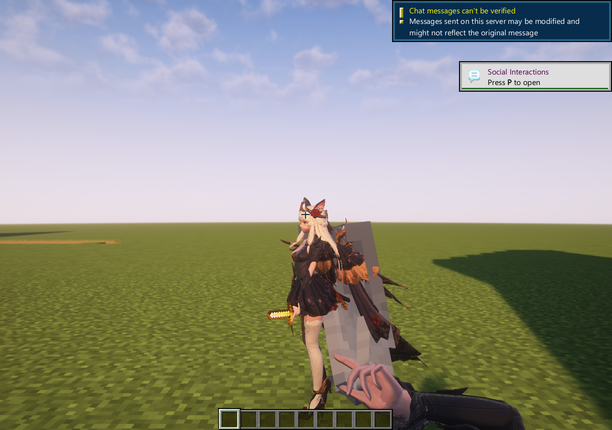
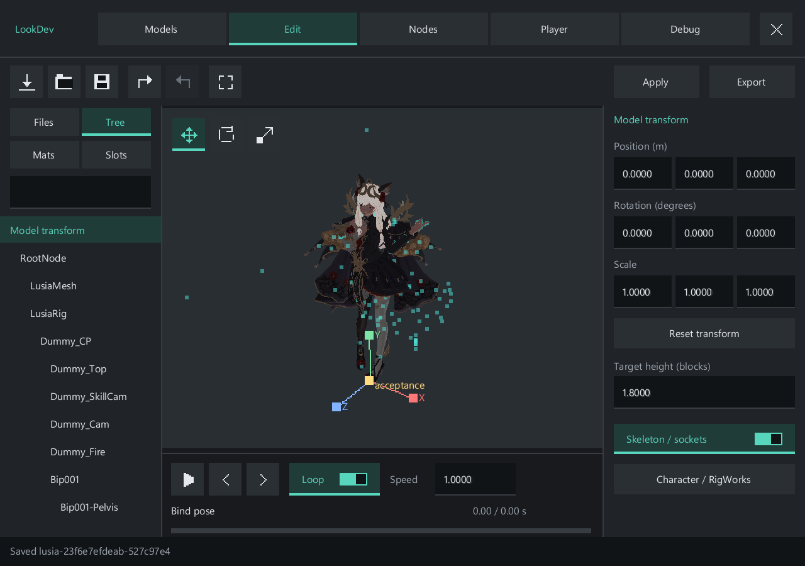
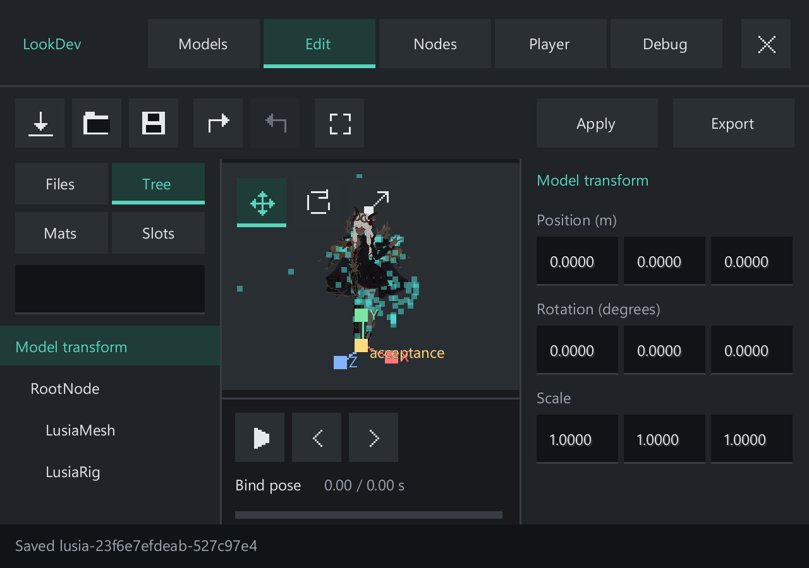
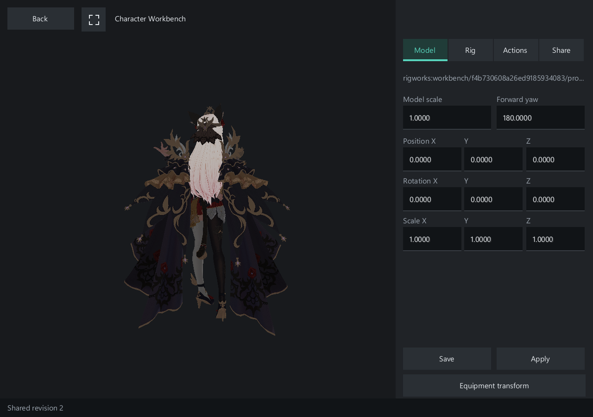

# RigWorks 配置分享与工作台验收

日期：2026-11-18。对应当前工作树，未提交或推送。使用说明见 [角色配置同步](CHARACTER_CONFIGURATION_SYNC.md)、[专用动作脚本](AVATAR_BEHAVIOR_RUNTIME.md) 和 [模型工作台](MODEL_WORKBENCH.md)。

## 环境与结论

Forge 1.20.1、Java 17，两个独立开发客户端通过真实 TCP 连接到集成 LAN 服务器。两端预先安装相同 Lusia 本地资源包，接收端没有作者的 Avatar 源码包。Oculus、Embeddium、ModernUI、F3Tweaker 和 KubeJS 开发依赖保留，世界画面使用当前 RocketFlow 本地光影。

本轮通过配置和脚本初次分发、远端执行、显示开关、内容更新与基本工作台操作。没有传输 FBX 或贴图，没有重载全局 KubeJS 环境。验收入口完成后均不主动退出游戏；最终复核的工作台客户端保持打开。

测试入口显式关闭一次性 LAN 世界的认证，使用不同的离线开发身份。该设置仅在启用 `charactersynctest.role` 的集成测试类中执行，不进入发布 JAR，不修改正常服务器认证。此次成功不证明正常认证登录或专用服务器已验收。

## 构建

```powershell
.\gradlew.bat build compileIntegrationTestJava :rigworks:compileIntegrationJava --console=plain
```

结果：`BUILD SUCCESSFUL`。AssimpLoader、AssimpShowcase、RigWorks 三个 JAR 的模块隔离检查通过。JUnit 报告共 558 项，0 失败、0 错误、2 项跳过；测试报告中未变化的任务由 Gradle 复用。最后调整截图等待条件后，另执行 `compileIntegrationTestJava` 成功，发布代码未再变化。

## 真实双客户端

测试类：`CharacterSharingSmokeTest`。本轮目录为 `build/character-sync-owner5`、`build/character-sync-viewer5` 和 `build/character-sync-coordination5`。协调文件只交换断言与进度；配置、源码和角色状态经过实际 RigWorks 网络通道。

| 检查 | 实际结果 |
| --- | --- |
| V1 发布 | 服务端接受 `configRevision=2`，配置包与源码哈希一致 |
| 接收端首次安装 | 没有本地作者包，下载完成后建立远端 binding，专用脚本开始执行 |
| 关闭他人角色 | 远端 binding 移除；脚本调用数保持不变；验证过的缓存保留 |
| 重新开启 | 从已校验配置恢复，脚本调用数继续增加 |
| V2 更新 | 修改左右手装备偏移、根 yaw，并更新 JSON 与 JS；服务端接受 `configRevision=5` |
| 接收端替换 | profile、装备定义、配置摘要、包哈希、源码哈希均与 V2 一致 |
| 实际绘制 | 结果记录一个远端 binding、18 次远端绘制、87 次脚本调用，失败集合为空 |
| 磁盘缓存 | 服务端与接收端保留同名 `.bin`；重新解码后规范包哈希一致；接收缓存没有 `.js` |

V1 压缩包 1442 字节，V2 为 1445 字节。这只代表本次小型测试包，不是所有角色配置的大小或网络性能指标。接收缓存按世界身份分桶，两个版本暂时共存，后续由预算淘汰策略处理。

原始结果：[发布端](validation/rigworks-2026-11-18/owner-result.json)、[接收端](validation/rigworks-2026-11-18/viewer-result.json)。



## 工作台

测试类：`WorkbenchSmokeTest`。最终独立复核目录为 `build/workbench-final-acceptance`，导入 27380 三角形、带骨骼的 Lusia FBX。

| 检查 | 实际结果 |
| --- | --- |
| 导入与渲染 | 独立预览绘制成功，无 OpenGL 错误，六个材质准备完成且无失败 |
| PBR 缓存 | 通用预览与角色扩展预览均建立 10 张 normal/specular GPU 纹理；不依赖 Oculus 子纹理 ID |
| 编辑隔离 | 修改金属度、粗糙度与发光，没有改写导入 Scene 的原材质 |
| 历史记录 | 普通撤销/重做、回退通过；撤销已选 Socket 后清除失效选择，重做可恢复 Socket |
| 保存 | 项目正式保存后 dirty 状态清除 |
| 布局 | 1280×900 下 GUI 缩放 2/3 的可见控件均在窗口内；截图人工检查无面板文字覆盖 |
| 扩展 | 可打开 RigWorks 的角色编辑页，贴图就绪后截图 |

原始结果：[工作台记录](validation/rigworks-2026-11-18/workbench-result.json)。角色扩展首次进入会重新准备失效的材质缓存，截图入口现等待实际 GPU 贴图就绪，避免把加载中的灰色材质作为最终画面。







独立预览使用固定光照与简化 PBR，不能与世界中的完整 Oculus 光照逐像素对齐。截图中角色朝向由当前根 yaw 决定，可在视口拖动观察其他方向。

## 本轮发现并处理

- NightConfig 自动保存与 Forge 热重载同时修改数据，可能把人物选择重置：改为完整配置事务、同目录临时文件替换和受同一锁保护的客户端线程监听。
- 调试几何读取已经关闭的物理 actor：诊断入口过滤已关闭实例，并补生命周期回归测试。
- 撤销已选 Socket 后 Inspector 仍访问旧选择：历史切换刷新列表并清除失效选择，实际客户端撤销/重做通过。
- 独立预览依赖 Oculus 延迟生成的子纹理：预览器复用已解码 PBR 图片并拥有自己的 GPU 纹理，按来源变更释放。
- 个别接收者目录发送失败影响其他接收者或成功确认：按接收者隔离发送，失败目录进入有界退避补发队列；新版本和连接状态在重试时重新读取。
- V2 断言曾在异步替换完成前检查旧 binding：验收改为等待当前 binding 与权威配置一致。保留旧有效实例本身符合预期。

YSM 对比中提到的“上传分片结束后缺少 revision 二次检查”经源码复查不成立：包解码后仍经过 `acceptPackage -> CharacterVisualLedger.commit` 的 CAS。无需再加一套平行版本逻辑。

## 未覆盖范围

- 专用服务器、正常认证登录、断线重连、跨维度、服务器重启后的完整客户端恢复，以及恶劣网络和多人规模。
- 目录补发的真实故障注入；目前有队列单元测试，未在本轮人为破坏网络发送。
- 任意全局 KubeJS `client_scripts` 的同步。当前仅支持专用 Avatar API，收到的脚本不获得 Java、文件或网络访问能力。
- 通用项目任意节点、材质与 Socket 的多人同步；当前分享的是 RigWorks 角色快照及专用行为包。
- 全部动画的动态画质、所有分辨率和光影，以及 FPS/GPU 性能基准。当前静态截图不能证明运动拖影已完全消失。

压缩缓存不是加密或防提取机制，也不是零拷贝。脚本运行有指令、深度、输入输出和时间限制，但进程内解释器不等于独立进程的内存隔离。

## 复现入口

使用一次性存档及独立游戏目录，两端预先安装相同模型资源，发布端选择该角色，清空该测试角色的旧作者包。`runClient` 可用 `clientCharacterSyncRole=owner/viewer`、`clientCharacterSyncWorld`、`clientCharacterSyncPort`、`clientCharacterSyncCoordination` 和 `clientUsername` 属性启用双端测试；协调目录每轮新建。测试会在一次性作者目录创建配置与脚本，不应指向日常使用的作者项目。

工作台入口为 `clientWorkbenchSmoke=<一次性存档名>` 和 `clientWorkbenchAsset=<本地 FBX 路径>`。PowerShell 中把每个 `-P...` 参数单独加引号。两类入口均只在 opt-in 集成 source set 中存在，成功或失败都不主动退出游戏。
