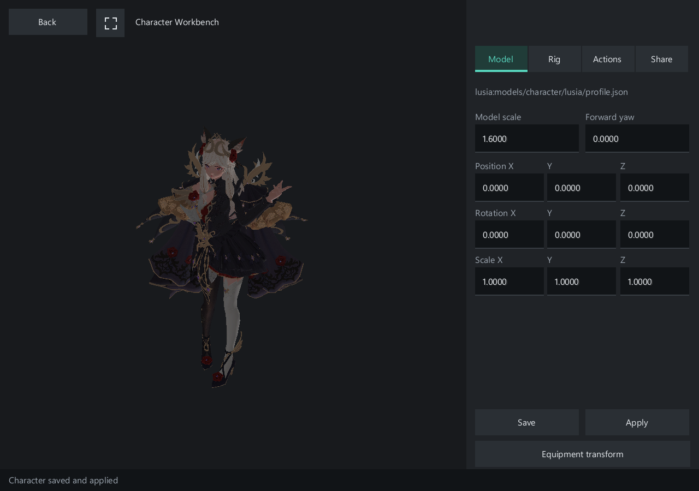

# 工作台保存与角色继承修复

日期：2026-11-18。

## 用户问题

Lusia 在角色编辑器中放大并 Apply 后只剩待机；重新选择原角色又恢复原状。另一个问题是编辑过的 JSON 再次读取时，旧参数是否会覆盖已经保存的内容。

检查实际项目发现，比例已经保存，但生成的临时角色使用空骨骼、空动作映射，丢失了原角色身份。角色 JSON 的读一次缓存和独立保存入口还会让编辑器继续使用旧快照。

## 修复

- 导入的模型副本按模型字节 SHA-256 匹配当前角色，保留原 profile ID、骨骼校准、动作、装备、Rig/物理和视觉配置。KubeJS 仍能按原身份选择行为。
- 已保存的旧版空映射临时角色，只在原角色与 FBX 哈希一致、且符合旧生成配置特征时恢复。保留用户保存的比例、yaw、根变换和视觉选项。恢复结果写入项目草稿。
- 角色页 Save 同时保存所属工作台项目。Apply 等待项目写入成功后应用实际保存的快照；保存期间的新编辑继续保留为未保存状态。
- 首次保存将文件资产引用更新到项目副本，保存过程保持同一个编辑会话、最新参数和撤销历史。
- 明确的角色 Reload、命令 Reload 和 F3+T 清除预览及配置缓存，重新读取角色文件和本地资产登记。
- 重开时比较角色文件与项目文件的修改时间；较新的角色文件可合并到项目草稿。已有未保存的角色修改优先保留，无关的材质草稿不阻止合并。
- 恢复草稿必须匹配正式文档的 SHA-256、资产身份和时间；过期、损坏或缺少版本关联的草稿不会挡住正式项目。
- 导入包含 `project.workbench.json` 的目录会打开项目。导入裸 FBX 仍创建独立项目。

## 使用

| 操作 | 结果 |
| --- | --- |
| 角色页 Save | 保存项目和角色配置 |
| 角色页 Apply | 保存成功后启用并应用角色 |
| Open 已有项目 | 从磁盘读取已保存参数，检查有效恢复草稿 |
| 手改角色 JSON 后 Reload | 清理旧缓存并重新读取 |
| 有未保存修改时重新 Open | 保留当前编辑，要求先保存或还原 |
| 再次 Import 裸 FBX | 创建独立项目，不覆盖原项目 |

## 验证

`gradlew test :rigworks:test compileIntegrationTestJava :rigworks:compileIntegrationJava` 通过。共 573 项测试，0 失败、0 错误、2 项跳过。新增覆盖包括原身份继承、旧配置恢复、保存期间编辑、保存基线、撤销历史、恢复版本校验和损坏草稿回退。

`gradlew build :rigworks:build` 通过，包括 AssimpLoader、Showcase、RigWorks 打包及模块边界检查。

独立客户端的 `WorkbenchPersistenceSmokeTest` 已验证：

| 检查 | 结果 |
| --- | --- |
| 同字节 FBX 副本继承原角色完整配置 | 通过 |
| 比例 1.2，Save/Apply 后重新打开 | 仍为 1.2 |
| 外部角色 JSON 改为 1.4 后 Reload | 读取 1.4 |
| 外部项目 JSON 改为 1.6 后重新打开 | 读取并应用 1.6 |
| 磁盘文档与已保存编辑器文档一致 | 通过 |
| 原 Lusia 脚本接收走路、跑步、待机输入 | 通过 |
| 独立预览贴图就绪及 PBR 贴图数 | 通过，10 张 |

验收 JSON：[workbench-persistence-result.json](validation/rigworks-2026-11-18/workbench-persistence-result.json)。

测试入口只在 JVM 参数 `-Drigworkspersistence.enabled=true` 时运行；另需
`-Drigworkspersistence.world=<独立世界名>` 和
`-Drigworkspersistence.asset=<同一角色 FBX 路径>`。使用可丢弃的游戏目录和世界，
预先选择有 KubeJS 控制器的 Lusia。测试会创建项目、修改该目录下的角色/项目配置，
成功或失败都不会关闭客户端。

动作检查使用实际 KubeJS 控制器和合成运动输入，不能代替所有键盘动作组合的人工验收。本轮未修改网络协议，也未重复多人分发测试。原有客户端保持打开；旧 JVM 不会自动获得新编译的 Java 实现。

操作说明见 [模型工作台](MODEL_WORKBENCH.md)，保存接口和恢复格式见 [项目格式](WORKBENCH_PROJECT_FORMAT.md)。
