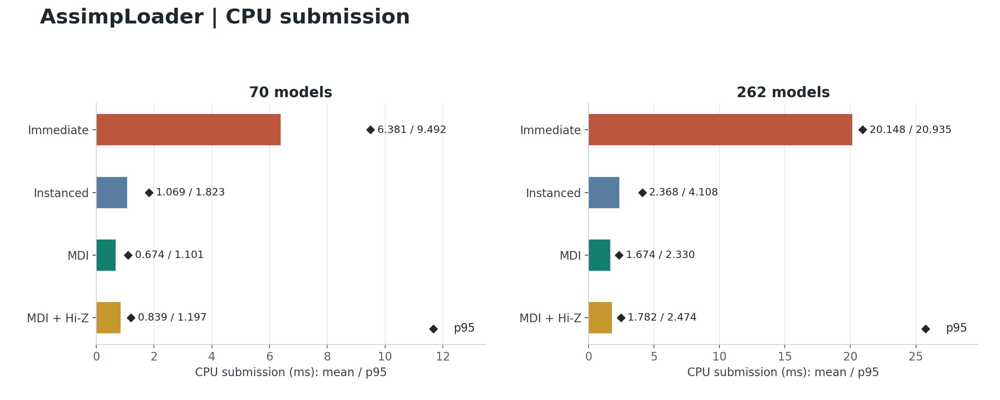
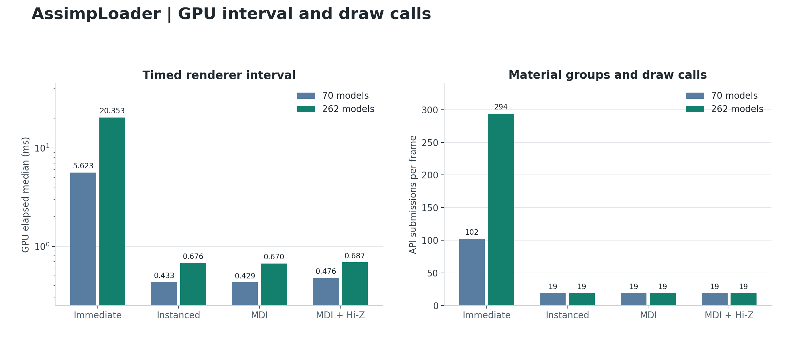
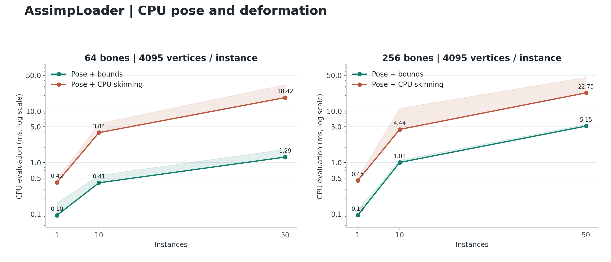
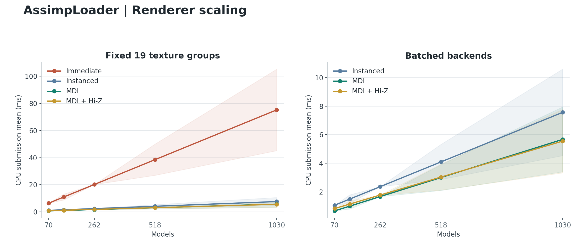
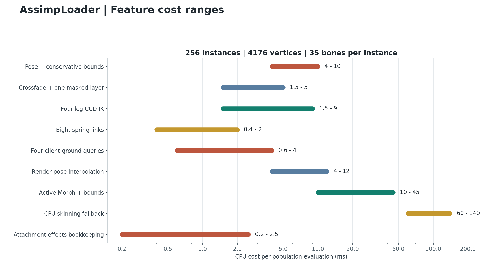
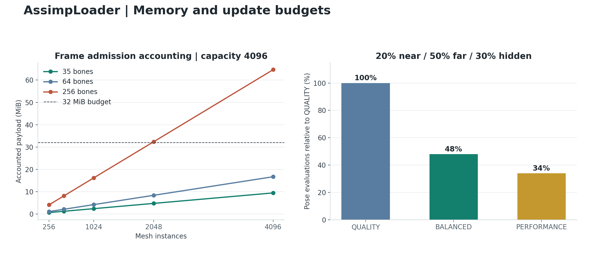

# AssimpLoader 渲染性能图表与评估

日期：2026-11-17。依据提交 `1ea2758` 的代码及此前保存的数据整理，本轮没有启动客户端、运行 Gradle 或重新采集性能样本。

**数据说明：第 1、2、3 节为历史实测；第 4 节除两个实测锚点外，均为经验数据；第 5 节全部为人工填写的经验数据；第 6 节为代码布局和配置公式计算。经验区间用于容量规划，不是测量值、统计置信区间或性能承诺。** 图表只展示技术名称、指标与数值，数据来源及适用条件在本文说明。

## 结论

目前最明确的收益来自减少重复绘制提交：262 个混合模型下，MDI 将 CPU 提交均值从 20.148 ms 降到 1.674 ms，约为原来的 1/12.04；API 提交从 294 次降到 19 次，减少 93.54%。这两个比例只属于既有受控渲染负载。

动画、IK、Spring、Morph、插值与边界计算仍有独立成本。批处理解决提交压力后，它们更可能成为大规模动态实例的瓶颈。优先采用实例更新降频、功能预算、缓存和批次连续性优化；Native/SIMD 保留给后续确认的密集计算热点。

## 1. CPU 绘制提交

**历史实测。** 来源为运行 `1794843724825` 的 [GPU 批处理验收](../history/GPU_BATCH_VALIDATION_2026-11-16.md)，保留表格见 [gpu_batch.csv](data/gpu_batch.csv)。RTX 4060、OpenGL 4.6、Java 17；CPU 硬件现查为 Xeon E5-2697 v2，本轮没有重测。该硬件档次也作为后文经验数据的参考。



每组为 64/256 只鹿、4 个 256 骨骼夹具和 2 个静态模型，共 70/262 个模型、102/294 个 mesh 实例。两件静态模型共用实际资源包中的大模型，每件有 17 个 mesh、608253 个顶点。总提交顶点数约为 151 万/231 万。

姿态在计时期间冻结，导入和首次几何上传不计入。条形为 CPU 均值，菱形为 p95。这不是持续动画、世界完整帧耗时或服务器 TPS。

| 模型数 | 路径 | CPU 均值 ms | CPU p95 ms | API 提交 |
|---:|---|---:|---:|---:|
| 70 | Immediate | 6.381 | 9.492 | 102 |
| 70 | Instanced | 1.069 | 1.823 | 19 |
| 70 | MDI | 0.674 | 1.101 | 19 |
| 70 | MDI + Hi-Z | 0.839 | 1.197 | 19 |
| 262 | Immediate | 20.148 | 20.935 | 294 |
| 262 | Instanced | 2.368 | 4.108 | 19 |
| 262 | MDI | 1.674 | 2.330 | 19 |
| 262 | MDI + Hi-Z | 1.782 | 2.474 | 19 |

## 2. GPU 区间与提交次数

**历史实测。** 与第 1 节是同一轮运行；左图使用对数轴以显示低于 1 ms 的差异。



GPU 中位数：70 模型下分别为 5.623 / 0.433 / 0.429 / 0.476 ms；262 模型下分别为 20.353 / 0.676 / 0.670 / 0.687 ms。timestamp 区间包含 CPU 提交造成的命令流空隙，不能据此宣称顶点着色器运算本身快了三十倍，也不能将 CPU/GPU 区间直接相加后倒数生成 FPS。

Instanced 与 MDI 都是 19 次提交，因为本场景有 19 个纹理分组。MDI 的价值是减少提交端开销，并在 Hi-Z 使用每实例独立 indirect command 时仍保留分组调用。Hi-Z 分别剔除 13/102、49/294 个 mesh 实例，但整体略慢于 MDI；本轮资料不支持默认开启 Hi-Z。

## 3. CPU 姿态与蒙皮

**历史实测。** 原始文件为此前生成的 `build/reports/runtime-benchmark.json`，本次整理为可提交的 [cpu_pose.csv](data/cpu_pose.csv)。记录环境为 Windows 11、Java 17.0.18、24 个逻辑处理器，100 次预热、120 次采样。原始 JSON 未记录提交号及采集时间，因此作为历史基线，不能等同于当前版本重新测得的结果。



每实例为 4095 个顶点、4 权重的合成资产；64/256 骨骼都参与权重，求值包含姿态发布和边界。线为中位数，浅色范围延伸至 p95；纵轴为对数。夹具不包含真实鹿的动作复杂度、IK、Spring、地形采样或绘制编码。

| 骨骼数 | 实例数 | 仅姿态中位数 ms | 姿态 + CPU 蒙皮中位数 ms | 后者 p95 ms |
|---:|---:|---:|---:|---:|
| 64 | 1 | 0.0953 | 0.4152 | 0.4851 |
| 64 | 10 | 0.4070 | 3.8424 | 5.8021 |
| 64 | 50 | 1.2867 | 18.4164 | 32.9536 |
| 256 | 1 | 0.0960 | 0.4499 | 0.5103 |
| 256 | 10 | 1.0118 | 4.4368 | 11.4453 |
| 256 | 50 | 5.1465 | 22.7511 | 45.9178 |

经验判断：全量 CPU 蒙皮回退比普通骨骼求值更需要防止规模失控。骨骼增加会推高姿态/边界成本；顶点数、活动 Morph 和绘制编码会进一步放大 CPU 压力。单实例结果受 JIT、计时和固定成本影响，不能简单乘以 256；后文主要使用 50 实例数据作为参考。

## 4. 实例规模推算

**经验数据：134、518、1030 模型的数值及阴影区间为推算；70、262 模型沿用历史实测。** 每组始终保留 4 个高骨骼夹具和 2 个静态大模型，只增加鹿的数量。纹理分组固定为 19，不增加光影通道或动作求值。



| 模型数 | 数据性质 | Immediate ms | Instanced ms | MDI ms | MDI + Hi-Z ms |
|---:|---|---:|---:|---:|---:|
| 70 | 历史实测 | 6.381 | 1.069 | 0.674 | 0.839 |
| 134 | 经验数据 | 10.970 | 1.502 | 1.007 | 1.153 |
| 262 | 历史实测 | 20.148 | 2.368 | 1.674 | 1.782 |
| 518 | 经验数据 | 38.504 | 4.100 | 3.007 | 3.039 |
| 1030 | 经验数据 | 75.216 | 7.564 | 5.674 | 5.554 |

计算：`T(N) = T(70) + (N - 70) × (T(262) - T(70)) / 192`。134/518/1030 模型分别手动保留 ±20%/±30%/±40% 的经验余量。阴影不是采样误差或统计区间。线性外推会使 Hi-Z 曲线在大规模时略低于 MDI，这是拟合斜率的结果，不是观测到的交叉点，也不是启用 Hi-Z 的依据。

这些推算要求批次不被透明绘制、特效、不同 framebuffer 或其他模组频繁切断。世界实际绘制可能退化为多个小批次；此前单鹿世界验收只证明生命周期与路径可用，没有证明这张规模曲线。

## 5. 动态功能开销评估

**本节全部为人工填写的经验数据，没有独立运行测量。** 参考负载为 256 个实例，每实例 4176 顶点、35 骨骼，资产已预热。单位是“全体实例完成一次对应求值的 CPU 毫秒”，不是每个渲染帧固定追加的成本。普通模拟一般按 20 Hz 或更低频率更新；插值按生成新视觉相位的频率发生。



| 功能 | 经验数据 ms/全体求值 | 手工评估依据 |
|---|---:|---|
| 基础姿态 + 保守边界 | 4-10 | 历史 64 骨骼、50 实例姿态结果换算至 256 实例，考虑鹿骨骼较少及 JIT/缓存差异 |
| Crossfade + 一层 mask | 1.5-5 | 额外片段采样、局部 TRS 混合；不重复计入基础姿态发布 |
| 四腿 CCD IK | 1.5-9 | 每腿 3 关节、最多 8 次迭代；目标收敛程度影响很大 |
| 8 节 Spring | 0.4-2 | 两子步、每实例 4 个局部球/胶囊接触体 |
| 4 次客户端地形查询 | 0.6-4 | 只访问已加载区块，局部有界 shape 查询；复杂碰撞形状可能超出区间 |
| 渲染姿态插值 | 4-12 | 每实例生成一个新相位，重建层级/palette/边界；不含 Morph 和上传 |
| 活动 Morph + 边界 | 10-45 | 4 个稠密位置/法线目标；CPU delta 与边界工作，不含蒙皮 |
| CPU 蒙皮回退 | 60-140 | 50 实例历史结果中蒙皮额外部分扩展至 256，留宽余量；不含顶点编码 |
| 挂点特效记账 | 0.2-2.5 | 两发射器、一条 32 样本拖尾；不含粒子自身模拟和实际光栅化 |

各项不能直接相加：层混合、IK、Spring 共用姿态发布；Morph 的变形与边界可能重复访问数据；GPU 回退改变后续路径。所有区间依赖分配、GC、缓存、碰撞形状和功能参数。尤其是活动 Morph 即使使用 GPU 变形，目前 `PoseSnapshot` 的活动目标边界仍会调用 CPU `MorphDeformation.deform`，不能记为“CPU 零成本”。

## 6. 内存与更新频率

**本节为代码布局与预设算术，不是运行测量。**



批处理每 mesh 实例按 112 字节参数、32 字节 bounds、20 字节 indirect command、4 字节 visibility，加 `64 × 骨骼数` 字节 palette 核算。容量 4096 的 ID 缓冲预留 `4096 × 4` 字节，再加 64 字节保守余量：

```text
frameBytes = 4096 × 4 + 64 + meshInstances × (168 + bones × 64)
```

35 骨骼、4096 mesh 实例约需 9.42 MiB；256 骨骼约需 64.67 MiB。默认 32 MiB 帧预算，在该统一 256 骨骼假设下约可容纳 2026 个 mesh 实例，随后会切分批次或回退；4096 容量不是 4096 个高骨骼实例必能一次接纳的保证。此处不包含共享几何 arena、纹理、Hi-Z、驱动暂存或 Java 对象，也不是显卡驻留内存读数。

更新频率图假设 20% 近处、50% 远处、30% 隐藏，且已越过 visibility grace，分类稳定不变。QUALITY/BALANCED/PERFORMANCE 的理论姿态求值次数分别为 100%/48%/34%。它只反映求值次数；距离阈值、不同实例成本、跳过 tick 后累积步长、Spring 子步上限以及开启插值都会改变实际耗时。

## 7. 渲染管线技术评估

**下表为代码现状结合经验的定性评估，不表示每项都已有独立 benchmark。**

| 环节/技术 | 当前作用与成本 | 经验判断及配置方向 |
|---|---|---|
| Assimp 导入与资产共享 | 原生导入、网格/动画共享；首次导入和纹理上传有峰值 | 预热、稳定资源 ID、避免反复导入；不放入稳态绘制耗时 |
| JSON/TOML 与不可变策略 | 定义绑定及配置事件发布，绘制只读快照 | 保持解析离开热路径，不需要 Native |
| 状态机、crossfade、mask | Java 上每实例独立混合 | 优先减少远处层数和更新频率；成本取决于通道而非文件格式 |
| 姿态快照与动态 bounds | 缓存非 Morph 的骨骼 influence boxes，逐骨骼变换 | 保留粗粒度保守边界；不要每帧扫描全部蒙皮顶点来修复剔除 |
| IK 与地形对齐 | 本地世界采样、CCD 和有限身体校正 | 近处优先、限定迭代/查询数；客户端视觉不修改服务端碰撞 |
| Spring Bone | 有界固定子步和局部碰撞体 | 远处降频，传送重置；不是完整 Ragdoll/布料 |
| CPU 蒙皮与顶点编码 | 回退或 Oculus 兼容路径可能需要 | 大量动态网格的重点风险；优先命中缓存，之后才评估 SIMD/Native |
| VAO/VBO/EBO 与共享 arena | 减少重复格式设置和几何上传 | 静态几何共享收益可靠；arena 有上限，目前没有几何 LRU |
| Vertex Shader / TBO 蒙皮 | 骨骼 palette 上传，GPU 顶点变形 | 普通单通道动态网格的基础路径；上传和重复通道仍有成本 |
| Compute Skinning | 一姿态变形一次，输出 VBO 可复用 | 多通道复用可能获益；持续插值可导致每帧 dispatch，默认关闭；并未与当前 MDI arena 合并 |
| GPU Morph | TBO delta 降低顶点 CPU 变形压力 | 不消除 CPU 动态边界；活动 Morph 当前不进入批处理，目标数/存储需限额 |
| GPU Instancing | 同几何、同纹理实例归组 | 多实例有效；材质分裂、透明路径和频繁 flush 会限制收益 |
| MDI | CPU 一次提交一组 indirect commands | 本轮 CPU 提交收益明确；不会降低动画更新或单像素着色成本 |
| 视锥剔除 | CPU/宿主使用视觉 bounds 避免不可见提交 | 比 Hi-Z 更应先保证正确；边界过大降低剔除效率，过小会闪烁 |
| 同帧 Hi-Z | 深度金字塔、GPU bounds 分类、command masking | 稠密遮挡且几何昂贵时才可能抵消 dispatch 成本；默认关闭，未做 visible compaction |
| Render 插值 | 提升视觉相位连续性，生成新姿态 | 不是提速开关；可能增加 CPU 求值、蒙皮、上传和缓存失效 |
| Oculus posed VBO cache | 同姿态在主/阴影 pass 复用编码与上传 | 先利用复用；历史区间 4221 次 draw / 626 次上传，3595 次复用约占 85.17%，不是 FPS 增幅 |
| PBR、光照与雾 | 现有材质着色及 Oculus shader pack 决定着色成本 | 分辨率、覆盖面积和贴图采样可主导 GPU；本轮没有独立材质耗时，不能填固定 ms |
| 半透明、粒子与拖尾 | 排序、overdraw 和 BufferSource flush | 当前使用既有兼容路径；预算粒子/轨迹数量，避免把透明内容强行塞进 opaque batch |
| OBB/BONE/MESH 查询 | 本地显式查询；精细变形和 BVH 首建较重 | 粗筛后按需查询、复用同快照 BVH；不按所有实体每帧重建，不冒充服务器权威命中 |
| 资源重载与显存预算 | 线程内释放/重建、容量拒绝和回退 | 稳态与重载峰值分开；预算是核算上界，不是驱动物理驻留量 |
| SSAO/SSR/SSS/TAA/CSM 等 | 本次未新增自有完整后处理链；光影包能力另计 | 不填造完整管线的耗时，不据这些图宣称已完成对比模组全部功能 |

### 后续优先级

1. 让实际世界中的 opaque 批次持续覆盖多个实体，控制特效和其他即时绘制造成的过早 flush。
2. 结合实例距离与可见性预算动画、IK、Spring、地形采样，保持每实例独立状态。
3. 减少活动 Morph 边界 CPU 重算；评估保守目标包围盒或有界缓存，保证剔除正确。
4. 对插值按距离/资产启用，避免把所有 20 Hz 动作强制转为每帧全量 CPU 求值和上传。
5. 在连续动态、多通道场景确有瓶颈后，再选择 Compute 输出复用或 CPU 数据布局/SIMD/Native；不把当前提交端的 12 倍改善归因于 Native。

## 数据与重绘

历史数据完整保存在本文目录，无需 `build/`、`run/` 或资源包即可重绘。经验数字及假设位于 [pipeline_assessment.json](data/pipeline_assessment.json)，绘图程序只读取表格和生成静态文件，不执行任何游戏验证。

```powershell
py -3.10 tools/plot_render_benchmarks.py
```

依赖 Python、Matplotlib、NumPy。本机 Python 3.10 环境已有这些依赖。输出为 `charts/` 中六张 PNG 与对应 SVG，可分别用于文档预览和矢量导出。历史逐帧原始记录和更完整验收限制见 [GPU 验收报告](../history/GPU_BATCH_VALIDATION_2026-11-16.md)、[Compute 说明](../reference/COMPUTE_SKINNING.md)、[Oculus 缓存](../reference/OCULUS_POSE_BUFFER_CACHE.md)、[插值说明](../reference/RENDER_POSE_INTERPOLATION.md) 与 [运行时性能模式](../reference/RUNTIME_PERFORMANCE_MODES.md)。
