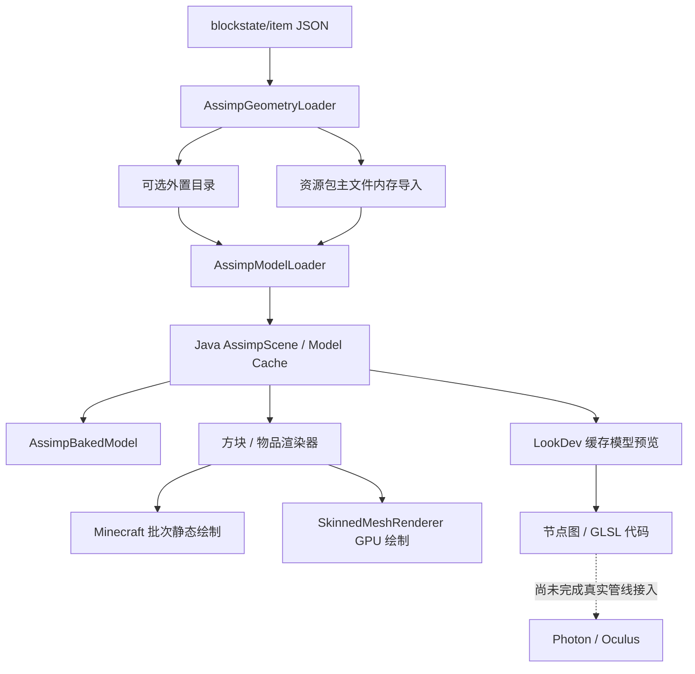

# AssimpLoader 审计报告

> 后续变更：CNC/CCB 示例已按用户要求移除。本文中的原注册 ID、修复过程和运行记录保留为审计当时的事实；当前示例见 [世界展示](../showcase/MODEL_SHOWCASE.md)，不要再使用旧 ID 复现。

> 本文保留首轮审计交付时的状态快照。随后用户授权继续修复；当前条目处理状态、验证结果及功能调整请看 [修复与验收记录](FIXES_2026-11-13.md)。下文的“未修复”不再表示最新工作区状态。

日期：2026-11-13。范围：`H:\MinecraftMods\AssimpLoader`。基线：分支 `feat/oculus-injector`，提交 `ab9318e`（2026-10-24）；开始时工作区干净。本报告包含本次未提交修复。

## 结论

项目已有可构建的 Assimp 数据层、Forge geometry 接入、方块/物品渲染、GPU 蒙皮与 IK 基础，也有较多 LookDev 和兼容层代码。但历史文档明显高估了若干模块的接入程度，不能将编译成功或类的存在等同于功能完成。

本次修复了主路径中的矩阵、插值、顶点组装、GPU 数据打包、纹理绑定、物品投影、示例资源和开发启动依赖等 16 组问题。74 项测试已通过，开发客户端已成功进入集成世界。用户反馈当前测试模型的贴图正常，但物品比例过大；该问题尚未修复。

审计判断：基础模型加载和展示已有实际运行证据；骨骼层级、热重载生命周期、多材质、节点图持久化及着色器接入仍有明确缺陷。项目适合作为继续开发的基础，不能认定为全部功能完成或发布验收通过。按用户要求先交付报告，本报告交付时停止继续修改代码。

### 优先处理清单

| 优先级 | 问题 | 当前状态 |
| --- | --- | --- |
| P1 | R13：DYNAMIC 物品在没有动画片段时漏用场景节点变换，CIWS 物品比例异常 | 用户已复现过大；代码路径已定位，未修复 |
| P1 | R01：非加权父节点、多根骨骼与 bind pose 丢失 | 静态代码确认；相关复杂模型未实机验收 |
| P1 | R04：重载后的动画状态和 GPU 资源没有统一失效/释放 | 静态代码确认；重复重载压力测试未运行 |
| P2 | R02/R03/R05：侧文件、缓存名称、加载超时语义 | 已确认接入限制，未修复 |
| P2 | R07/R08：多材质选择、法线、节点连接与保存 | 已确认特定输入会出错，未修复 |
| 功能未闭合 | R09/R10/R11：真实 shader 注入、LookDev 文件导入、Gaussian 世界入口 | 不应按“已经完整集成”对外描述 |

这里的 P1 表示对受影响场景有较大功能影响，不代表安全漏洞等级。以下所有“已修复”仅指工作区代码已修改，尚未提交或重新发布。

## 范围与方法

- 阅读 README、配置、构建/CI、阶段文档和近期 Git 历史；没有找到适用的 `AGENTS.md` 或 `CLAUDE.md`。
- 按加载/动画、渲染/兼容、LookDev/节点/构建三个方向检查，使用 GPT 子代理分工，并由主线复核和统一验证；模型导出及展示属于后续追加工作。
- 覆盖 `core`、`model`、`resource/cache`、`animation/ik`、`render/rendering`、`hotreload`、`lookdev`、`compat`、示例资源与发布元数据。
- 使用调用点搜索、Git 回归定位、本地依赖字节码检查、JUnit、真实 Assimp 原生导入、基线发布包检查及开发启动探测。
- 这是主要子系统的静态审计与针对性验证，不是所有文件逐行形式化证明，也不是全部模型格式、GPU 或整合包的兼容认证。
- 未使用 OpenCode/LongCat，遵循用户后续指定的 GPT 子代理要求。未提交 commit、部署到正式游戏实例或修改独立服务端 EULA。

## 架构与实际入口



主要入口：

| 模块 | 入口 | 状态 |
| --- | --- | --- |
| 模组和客户端事件 | `AssimpLoader`、`ExampleClientEvents`、`LookDevKeybind` | 有注册路径 |
| 模型数据 | `AssimpModelLoader`、`AssimpScene`、`AssimpMesh` | 已复制到 Java；主解析路径会在 finally 释放原生 scene |
| 场景/骨骼 | `AssimpNode`、`AnimationPlayer`、`BoneHierarchyBuilder` | 已实现，但完整父层级仍有问题 |
| 方块/物品 | `CCBBlockEntityRenderer`、`AssimpItemRenderer` | 原示例 ID 是 `assimploader:cnc`，模型缓存名是 `ccb`；本次另加六种 showcase 方块/物品 |
| IK | `IKManager`、`Skeleton`、controllers | 既有 48 项单元测试集中在此及动画集成 |
| 资源/缓存 | geometry + 静态 modelCache + hotreload | 真实加载路径与一些未使用的管理器并存 |
| LookDev | `lookdev/ui/LookDevScreen` | 按 L 打开；`loadModel` 仅查询模型缓存 |
| Gaussian | `rendering/splat`、`io/splat` | 原型代码；当前没有世界渲染入口 |

## 已修复问题

P1 表示会阻断主要功能、崩溃或使结果明显错误；P2 表示特定模型/配置缺陷或功能未完成。表内的验证只代表相应测试覆盖，涉及真实 GL 状态和画面的行为仍需客户端验收。

| ID | 级别 | 缺陷、修复与证据 |
| --- | --- | --- |
| F01 | P1 | [Keyframe](../../src/main/java/cn/minerealms/assimploader/animation/Keyframe.java) 同端点/单 key 插值除零产生 NaN。`975dee6` 切换到通道插值后暴露回归。现在处理零时长区间并钳制插值系数；`KeyframeTest` 覆盖常量通道和边界。 |
| F02 | P1 | [坐标转换](../../src/main/java/cn/minerealms/assimploader/util/CoordinateSystemConverter.java) 原四元数转换把旋转叠加两次。改为 `C * R * inverse(C)`；90 度旋转和 16 种坐标组合有测试。 |
| F03 | P1 | [AssimpNode](../../src/main/java/cn/minerealms/assimploader/model/AssimpNode.java)/[AssimpMesh](../../src/main/java/cn/minerealms/assimploader/model/AssimpMesh.java) 把 Assimp 行字段直接按 JOML 列构造，平移进入透视分量；节点/offset 与顶点坐标基还不一致。统一复制和换基，递归传递源坐标系。原生 glTF 测试比较 STATIC 与 DYNAMIC 结果。 |
| F04 | P1 | [BaseAssimpRenderer](../../src/main/java/cn/minerealms/assimploader/render/base/BaseAssimpRenderer.java) 在 QUADS 批次每面只提交三个顶点，导致相邻三角形串面/缺面；回归来自 `faf7b5e`。恢复 `i2,i1,i0,i0` 退化四边形；测试验证两个面产生八个顶点。 |
| F05 | P1 | [BoneMatrixTBO](../../src/main/java/cn/minerealms/assimploader/render/BoneMatrixTBO.java) 使用不推进 position 的 `Matrix4f.get(buffer)` 再 flip，导致矩阵覆盖同一位置且上传范围为空。本地 JOML 字节码确认；改为按 `i*16` 写入并显式 limit。测试覆盖多骨骼和缓冲区复用。 |
| F06 | P1 | [SkinnedMeshRenderer](../../src/main/java/cn/minerealms/assimploader/rendering/SkinnedMeshRenderer.java) 未设置骨骼 samplerBuffer 单元，与 albedo sampler2D 默认同占 unit 0。现显式使用骨骼 unit 1、albedo unit 0。 |
| F07 | P1 | 同一 renderer 使用 `RenderSystem.setShaderTexture` 配合原始 GL program，但该 API 只更新 Minecraft 延迟 sampler 数组。已切到实际纹理绑定；以本地 Minecraft 字节码核对。 |
| F08 | P1 | [SkinnedMeshVBO](../../src/main/java/cn/minerealms/assimploader/rendering/SkinnedMeshVBO.java) 无 UV 时 NPE；配置允许 1-8 权重，打包却假定源始终为四槽。现提供缺省 UV/normal，按实际源 stride 读取、归一化为 GPU 四槽；无有效权重时保持单位变换。纯数据测试覆盖相关输入。 |
| F09 | P1 | [物品渲染器](../../src/main/java/cn/minerealms/assimploader/render/AssimpItemRenderer.java) 把 pose 当 MVP，缺投影/全局 view，且未像方块路径处理批次与 GL 绑定。两个入口统一调用 `renderWithPose`，计算 `Projection * GlobalView * Pose`，finally 恢复本路径改变的绑定。矩阵顺序有测试；GL 恢复仍需实机验证。 |
| F10 | P2 | [AnimatedBlockEntityRenderer](../../src/main/java/cn/minerealms/assimploader/render/base/AnimatedBlockEntityRenderer.java) 初始化失败声称回退却跳过蒙皮网格。现调用已有静态路径；物品禁用 GPU/初始化失败时也静态回退。失败编译的 shader/program 同时清理。 |
| F11 | P1 | [NodeGraphExecutor](../../src/main/java/cn/minerealms/assimploader/lookdev/nodeeditor/NodeGraphExecutor.java) DFS 已输出依赖优先顺序，末尾反转导致消费者先于源执行/发码。去掉多余反转；`ShaderGenerationTest` 覆盖乱序输入节点链。 |
| F12 | P2 | [ShaderCodeGenerator](../../src/main/java/cn/minerealms/assimploader/lookdev/nodeeditor/shader/ShaderCodeGenerator.java)/[GLSLFragmentGenerator](../../src/main/java/cn/minerealms/assimploader/lookdev/nodeeditor/shader/GLSLFragmentGenerator.java) 在 emitNode 注册 uniform 前写出声明，纹理/时间变量遗漏。改为先生成计算体再输出声明；纯生成过程与 Photon 运行检测解耦。测试覆盖 full shader 的时间/纹理及 fragment 纹理声明。 |
| F13 | P1 | 唯一注册的 `cnc` 没有对应 blockstate/item JSON，renderer 又按 `cnc` 查询实际缓存名 `ccb`。新增两个资源引用，`AssimpBlockItem` 支持显式模型名并用于示例；保持原注册 ID。资源链与实际 FBX 内存导入有测试。 |
| F14 | P2 | [mods.toml](../../src/main/resources/META-INF/mods.toml) 未声明直接使用的 ModernUI 客户端硬依赖。新增 `modernui [3.11.0.1,4)`；版本依据本地 Forge jar 的 mod 元数据，与配套 Core 3.11.0 区分。 |
| F15 | P2 | [AssimpGeometryLoader](../../src/main/java/cn/minerealms/assimploader/render/AssimpGeometryLoader.java) 外置目录允许 `../` 或符号链接越出根目录，非法配置路径在 try 外。现在检查规范化/真实路径边界，异常回退资源包；简单缓存名也统一移除所有格式扩展名。新增目录越界回归测试。 |
| F16 | P1 | [build.gradle](../../build.gradle)/[gradle.properties](../../gradle.properties) 的开发运行依赖不完整：ModernUI Core 未进入游戏 loader，Photon/LDLib 原始文件未反混淆，Core 3.12 与 Forge 3.11 字段契约不兼容，Maven 开发依赖又缺 Caffeine/Markdown 库。使用 `minecraftLibrary`、本地模块坐标加 `fg.deobf`，去掉覆盖默认 classpath 的 token；Core 配齐 3.11.0，并补 Markdown、Caffeine 3.1.7、Flexmark 0.64.8，排除重复 annotations；Assimp 禁止再次引入原版 LWJGL core。修正后客户端已进入世界。 |

GPU shader 仍每顶点最多消费四个影响。配置为 5-8 时当前使用源数据的前四项并重新归一化，不宣称八影响 GPU 蒙皮；导入端尚未按权重选取最强影响。

ModernUI 配对依据：[上游 3.11.0.1 对应的 gradle.properties](https://github.com/BloCamLimb/ModernUI-MC/blob/3ae864fc6e765243895d2169620bfeb38ddb1288/gradle.properties)，其中 Core 是 3.11.0、LWJGL 是 3.3.1；本地 3.11 Forge 字节码访问的 `ModernUI.LOGGER` 在 Core 3.12 中已不存在。

## 剩余问题

以下是已确认的代码缺口或已复现问题，尚未在本次修复。优先级见前表；不要因构建通过而关闭这些问题。

### R01 骨骼完整层级

位置：[BoneHierarchyBuilder](../../src/main/java/cn/minerealms/assimploader/animation/BoneHierarchyBuilder.java) 的 `buildHierarchy` 和 `updateTransforms`。

只为有权重的 bone 建节点，丢弃 Armature/辅助父节点自身的变换；更新又只从首个 root 出发。具有非骨骼父变换或多根的模型可能仍然错位。应保留完整变换树，将 GPU palette 索引与层级节点分开，并用多 root、动画辅助节点及 bind-pose 样本验证。`resetToBindPose` 当前也把 local 设为单位矩阵而非导入的绑定姿态。

### R02 资源包侧文件

位置：[AssimpGeometryLoader](../../src/main/java/cn/minerealms/assimploader/render/AssimpGeometryLoader.java) 的资源包分支。

仅将主文件字节交给 `aiImportFileFromMemory`，没有资源 IO 回调，因此需要外部 `.bin` 的 glTF、依赖 `.mtl` 的 OBJ 等不能完整读取侧文件。这不等于 Assimp 不支持这些格式；是当前资源接入方式的限制。优先提供 ResourceManager 对应的 IO 适配，先用自包含 GLB/FBX 作为已支持路径。

### R03 模型名称和目录组织

简单缓存名全局共享，两个 namespace/目录中的同名文件仍可覆盖。外置目录目前按 resource path 查找而不包含 namespace。F15 只修复扩展名与边界问题；后续应统一完整 ResourceLocation key，并显式保留需要的兼容别名。

### R04 热重载失效和 GPU 释放

位置：[ModelHotReloadManager](../../src/main/java/cn/minerealms/assimploader/hotreload/ModelHotReloadManager.java)、当时的 `example/CCBBlockEntity.java`（该示例此后已移除）以及 block/item renderer。

- 清空的是 hotreload 自己的 `loadedModels`，删除的模型仍可残留在全局 `AssimpModelLoader.modelCache`。
- 方块实体保留旧 `AnimationState`，资源替换后未统一重新初始化；首次初始化太早也可能不再重试。
- 蒙皮 renderer 的 VBO cache 以旧 `AssimpMesh` 为强键，资源重载未接入 `clearCache/cleanup`；反复换模型会保留旧 Java/GPU 资源。
- 需要在渲染线程建立缓存代际和释放机制，并验证替换、删除、F3+T、关闭世界及退出客户端。

### R05 后台加载超时重复解析

位置：[AsyncModelLoader](../../src/main/java/cn/minerealms/assimploader/core/AsyncModelLoader.java) 的 `loadBlocking`。

调用方仍阻塞等待；15 秒后又在调用线程解析相同文件，后台任务没有结束，可能加倍 native/heap 开销。应明确超时语义和任务所有权，避免以“async”命名承诺界面不卡。取消 Java future 也不等于中断 Assimp 原生解析。

### R06 未接入管理器和配置

`ModelRegistry`、`ResourcePackIntegration`、`resource.TextureManager` 没有进入现有业务加载路径；`ModelCacheManager.loadModel` 仍返回 null。`hotReloadEnabled`、`hotReloadResourcePath`、部分缓存上限只有定义/读取，没有完整控制业务行为。

`FrustumCuller.updateFrustum` 没有外部调用；matrix overload 也未重建 frustum。不能将这些类的存在或配置项视为已经生效的资源管理/剔除功能。

### R07 多材质、透明度和法线

位置：[BaseAssimpRenderer](../../src/main/java/cn/minerealms/assimploader/render/base/BaseAssimpRenderer.java)、[AssimpItemRenderer](../../src/main/java/cn/minerealms/assimploader/render/AssimpItemRenderer.java)。

多个路径总是选第 0 张嵌入纹理，忽略 mesh material 的真实纹理索引/外部路径；部分纹理处理还把场景中任意透明材质的 opacity 应用到所有图像。场景节点变换直接修改 pose，但没有同步 normal 矩阵，旋转/非均匀缩放的光照可能错误。应以每 mesh 材质解析，并针对两材质、透明/不透明混合、带旋转缩放节点做视觉检查。

### R08 节点连接和持久化

位置：[NodeSocket](../../src/main/java/cn/minerealms/assimploader/lookdev/nodeeditor/NodeSocket.java)、`nodeeditor/serialization`。

- `NodeSocket` 只保存一个双向 connectedTo，输出连向第二个消费者时会断开第一个，画布连接列表可能与实际求值不一致。
- `NodeGraphSerializer` 没有完整保存各节点属性；UI 使用的 `MaterialSerializer` 也只识别部分节点类型，其他类型写成 UNKNOWN，数学模式及部分输入默认值不能完整往返。
- F11/F12 只修基本顺序/声明，不证明所有节点组合能正确保存或编译。应统一连接模型和序列化协议，保存前拒绝不能无损持久化的图，并增加跨版本往返样本。

### R09 着色器应用及 Oculus/PBR 接口

位置：[PhotonShaderCompiler](../../src/main/java/cn/minerealms/assimploader/lookdev/nodeeditor/shader/PhotonShaderCompiler.java)、`NodeBasedMaterial`、`DualModeShaderManager`、[OculusShaderInjector](../../src/main/java/cn/minerealms/assimploader/lookdev/iris/OculusShaderInjector.java)、[OculusPBRSupport](../../src/main/java/cn/minerealms/assimploader/compat/OculusPBRSupport.java)。

- 生成文件写入资源包目录但没有创建/启用对应 pack，也没有完成资源重载，随后直接从当前 ResourceManager 读取。
- GLSL 的 `texture_UUID` 与 JSON 的 `Sampler0`、运行绑定的 `u_TextureN` 不一致；矩阵 uniform 命名也不统一。
- Fragment emitter 只追踪部分 uniform，时间/光照节点和 manager 对“类型+名称”字符串的理解仍不完整。
- Oculus injector 当前处理硬编码测试模板，未获取/替换真实 Iris shader 源；`mixins.iris_compat.json` 没有实际 hook。MAIN_END 的 AST 插入点还映射为 translation-unit END。
- 本地 Oculus 1.8.0 jar 的 PBRTextureManager 位于 `texture.pbr` 包，现反射包名不匹配，且没有代码期待的 `setNormalTexture/setSpecularTexture` 方法。只改包名不足以完成修复。
- `PhotonIntegration` 把检测到 Oculus 等同 Photon shader 支持；当前下载的是 Photon 资源编辑器模组，不能由这些检测推断路径追踪能力。

这些路径应按具体目标 API 重新设计和接入；现在属于部分实现，不应以 success 日志或模板生成结果认定游戏着色器注入成功。

### R10 LookDev 模型和材质入口

位置：[LookDevScreen](../../src/main/java/cn/minerealms/assimploader/lookdev/ui/LookDevScreen.java) 的 `loadModel/extractMaterials`。

`loadModel` 只查缓存，没有实际磁盘解析。材质提取还有外部路径截取和资源名规范化问题；嵌入贴图使用 `lookdev/embedded_i`，与实际注册路径未形成统一契约。现有 UI 和数据类不等于“任意文件导入到完整 PBR 预览”的工作流已经闭合。

### R11 Gaussian 原型

位置：`rendering/splat` 与 `assets/assimploader/shaders/core/gaussian_splat.vert`。

- `faf7b5e` 删除了 Gaussian 方块/实体示例；当前 `GaussianSplatRenderer`、`SplatResourceManager` 没有外部业务调用点。
- CPU 每点布局是 `11 + shDim*3`，shader 却使用 `11 + sh_dim`，从第二个点开始读错。
- shader 强制 require SSBO；所谓 TBO fallback 没有对应可用 shader，order buffer 的空数据上传也会直接被拒绝。
- LOD 过滤后产生的是局部索引，却上传给原始点数据；draw 仍使用原始 count，可能重复/错误绘制。
- 深度排序使用了错误矩阵行；自写末尾 pivot 快排在已排序/等深数据上可退化为深递归，存在栈溢出风险。

该功能不在当前玩家入口中，不在本次主路径修复中扩建；接入前必须先修布局/索引/排序，再做 SSBO/TBO 分支测试与大点集压力验证。历史“完整集成”报告已加醒目更正。

### R12 发布范围和源码声明

当前 natives 面向 Windows/Linux/macOS x64，没有 ARM。`glsl-transformer/ANTLR` 是 compileOnly；运行环境是否提供对应版本不能仅由编译成功推断。Photon mixin 同时在元数据和初始化中声明，缺少 Photon 的实际启动组合仍需验证。

`mods.toml` 声明 MIT，但仓库没有独立 LICENSE；内嵌 `au.edu.federation` 源码也缺少来源/第三方许可说明。需补齐源码来源、版本和许可材料。本次没有替权利人编写许可文本，也没有进行第三方漏洞库或法律合规认证。

### R13 DYNAMIC 物品的静态节点变换与显示比例

位置：[AssimpItemRenderer](../../src/main/java/cn/minerealms/assimploader/render/AssimpItemRenderer.java) 的 `renderDynamicMode/renderNodeAnimatedMesh/applyItemTransforms`，以及 [SimpleMeshRenderer](../../src/main/java/cn/minerealms/assimploader/rendering/SimpleMeshRenderer.java)。

用户在本次开发客户端中确认：测试模型的贴图可见且效果正常，物品模型过大。CIWS 使用 DYNAMIC 导入且没有 baked animation；其 `AnimationState` 初始化成功后进入逐 mesh 路径，但没有 current animation 时传入的 nodeTransforms 为 null。`SimpleMeshRenderer` 此时不应用导入场景的父节点/静态节点矩阵，FBX 节点承载的单位缩放及关节平移都会丢失。这是该显示异常的直接代码线索，尚未通过修复前后对比完成根因验收。

此外，物品缩放在 `applyItemTransforms` 中按显示场景硬编码，模型 JSON 的 display transforms 未传入 `AssimpBakedModel`，其 `getTransforms()` 固定返回 `NO_TRANSFORMS`。当前无法只改 JSON 就调整该缩放。应先恢复完整节点变换，再分别确认 GUI、第一/第三人称、掉落物、展示框的显示比例，避免以全局缩小掩盖单位错误。

`DYNAMIC` 表示保留场景层级/支持动画，与“Java 代码能热更新”不同。`F3+T` 会重建模型资源并走 geometry 加载路径，可以重新读取资源包里的模型和贴图；不会重载 Java 中写死的缩放逻辑，也不能视为 R04 的资源释放问题已经解决。按用户要求，本项记录后暂停修复。

## Git 历史线索

| 提交 | 本次审计的关联 |
| --- | --- |
| `975dee6` | 从 native scene 拷贝到 Java 并释放 import，方向正确；动画改道暴露单 key 插值缺陷 |
| `faf7b5e` | GPU 蒙皮接入方块、静态路径优化；静态 QUADS 回归与 Gaussian 世界示例删除都与此有关 |
| `4958653` | 增加外置目录和后台解码；仍有超时重复解析及部分配置未接入 |
| `d6eb23c` | 注册 LookDev 键与处理 IK 未加载配置，属于真实入口修复 |
| `f43405a` / `bc52759` | 将 Assimp natives 放入实际发布的 all jar，修正冷缓存配置解析 |
| `c6853e5` / `ab9318e` | CI 禁 daemon/并行，规避 ForgeGradle 冷缓存服务关闭问题；本次沿用相同约束 |

## 验证记录

环境：Windows 11 amd64、JDK 17.0.18、Gradle 8.8、ForgeGradle 6.0.54、Minecraft 1.20.1/Forge 47.1.3；不是全新依赖缓存。

| 检查 | 结果和边界 |
| --- | --- |
| 基线 build | 成功；既有任务多为 UP-TO-DATE，不能据此证明运行功能 |
| 最近已执行 test | 2026-11-13 09:37（XML 时间为 UTC 01:37），74 项全部通过、0 failure、0 error；包含原有 48 项和本次新增 26 项，覆盖真实 glTF/原示例 FBX 导入、矩阵、插值、顶点提交、TBO 打包、VBO、节点发码与资源引用 |
| 后续新增测试 | `ShowcaseAssetImportTest`、`ShowcaseAssetsTest` 共 4 项已加入，但尚未运行；不能计入上述 74 项 |
| 最新 Java/资源编译与开发运行 | 最近一次 `runClient` 已通过编译/资源处理并进入世界；这不等于最终 test/build 已统一完成 |
| 最终 build / all jar | 尚未重新生成和核对包含全部本次修改的发布包。`build/libs` 现存 jar 时间为 09:03/09:04，属于较早构建，不能作为本次修复的交付包 |
| `runServer --args=--nogui` | 启动器、依赖扫描与 Mixin 准备运行到 EULA 检查后退出；未接受 EULA，未创建世界，未验证完整服务端模组生命周期 |
| `runClient` 启动排障 | 先后发现 ModernUI 缺类、Photon/LDLib 未反混淆、LWJGL 重复模块、Core 版本不匹配、Caffeine 缺类与 annotations 重复；均已调整开发配置。最新日志在 09:59:36 启动集成服务器，10:00 起进入物品渲染 |
| 游戏内模型 | 日志确认 `cnc` 与 CIWS/刀/测试件的 give 和渲染路径；用户确认贴图效果正常，指出物品模型过大。六模型完整摆放、各视角、GPU 蒙皮和所有材质尚未完整验收 |
| 运行中残留日志 | 静态模型仍尝试申请 DYNAMIC AnimationState，出现找不到模式的日志；另有一次 GL_INVALID_ENUM debug 信息，来源未定位。均没有据此宣称运行无错误 |
| F3+T / 模组组合 | 本轮没有完成资源替换/删除、F3+T、无 Photon、带 Oculus/shader 的完整组合验证 |
| 冷缓存、Linux/macOS、ARM | 未运行；包内有 x64 natives 不等于这些平台已实机通过 |

后续复查命令（尚未将它们全部作为最终一轮执行）：

```powershell
.\gradlew.bat test --console=plain --no-daemon --no-parallel
.\gradlew.bat build --console=plain --no-daemon --no-parallel
git diff --check
```

测试报告：`build/reports/tests/test/index.html`；逐项 XML：`build/test-results/test/`。本次最近启动汇总日志是 `build/audit-run-client.log`；运行日志和 crash report 在 `run/logs/`、`run/crash-reports/`，属于本地生成证据。

构建复现注意：首次没有 Photon/LDLib 本地 jar 时，先单独执行 `.\gradlew.bat downloadDevDeps --no-daemon --no-parallel`，再启动下一次 Gradle 构建。依赖注册在配置阶段决定，不能把同一次 build 的前置下载任务当作已验证的冷启动闭环。

## 文档整理

- 新建 [文档索引](../README.md)，按当前入口、技术资料和历史记录组织。
- 更新根 README 的状态、ModernUI 版本、开发依赖、构建命令、目录结构和已知限制，移除不存在的开发文档/许可证链接。
- 重写 [快速开始](../guides/QUICK_START.md)，使用实际注册 ID 和可复现命令，移除其他机器的绝对部署路径。
- 给旧 [项目状态](PROJECT_STATUS.md)、[Gaussian 报告](../archive/GAUSSIAN_SPLATTING_REPORT.md)、[GLSL 完成报告](../archive/COMPLETION_REPORT.md) 添加历史/未接入说明，保留原阶段记录。
- 模型导出及追加展示工作的说明分别见 [测试资产](../guides/TEST_ASSETS.md) 和 [世界展示](../showcase/MODEL_SHOWCASE.md)。CIWS 为 2,572 三角面，刀为 162 三角面，测试件为 48 三角面，各有贴图/无贴图版本。CIWS 保留 Yaw/Pitch/Rotor 枢轴，本次没有实现自动跟踪或射击行为。

## 后续顺序

1. 报告交付后，先处理已复现的 R13 物品大小/节点变换，并确认 GUI、手持和世界显示；再完成最终 test/build 与发布包核对。
2. 修 R01、R04、R07，保证骨骼父层级、资源生命周期和多材质正确性；验证无 Photon、带 Photon/LDLib、带 Oculus 的启动/渲染组合。
3. 统一资源 key、侧文件 IO 和后台加载契约，补充替换/删除/异常配置测试。
4. 完成节点图无损持久化及真实着色器应用，再扩展 Oculus 和 Gaussian 原型。
